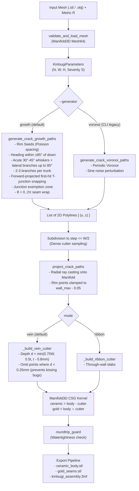

> [!NOTE]
> This document specifies **technical system architecture only** (data flow, storage, APIs, concurrency, state synchronization, and security).
> All visual, aesthetic, and UI design decisions (colors, typography, component styling, responsive layout) must be defined in `design.md`.

## Context

The system (`kintsugi-fracture`) fractures 3D vessel meshes driven by economic disparity $R$. The CSG boolean engine (`manifold3d`), swept convex-hull cutters (`_build_vein_cutter`, `_build_ribbon_cutter`), binary STL exporter, and 3MF container generator are mature and verified through rigorous 160-seed sweeps. The crack generator, however, previously used SciPy Voronoi diagrams perturbed by sine noise, which produced polygonal bathroom-tile geometry and suffered from noise-folding crossings (F18).

This architecture replaces the crack generator with a **Sequential Rim-Seeded Crack Growth Engine with Stop-on-Hit**, preserving the exact polyline interface consumed by the downstream pipeline.

## System Architecture Diagram

## Goals / Non-Goals

**Goals:**
- **Zero Crossings by Construction**: Eliminating F18 entirely without relying on global 2D displacement fields or Lipschitz bounds.
- **Organic Lightning Morphology**: Natural dendritic tree branching with acute $30^\circ\text{–}45^\circ$ whiskers, lateral linkers up to $85^\circ$, 2–3 branches per trunk, and authentic T-junctions.
- **Forward First-Hit Snapping & Shared Vertex Subdivision**: When a candidate segment approaches an existing segment within clearance, the travel vector is projected forward to a safe intersection and snapped to that shared vertex; on the final attempt, a near-miss bends directly onto the nearest point of the hit segment. The hit segment is subdivided so the vertex is explicitly shared by both polylines.
- **Kissing-Edge Prevention**: Omission of cutter points where $d < 0.25\text{ mm}$ prevents tangent non-manifold contact between the cutter spheres and outer surface.
- **Junction Exemption Zone**: Prevents newborn child branches from colliding with their parent segments at birth.
- **Drop-in Compatibility**: 100% preservation of downstream CSG, export formats, and REST API.

**Non-Goals:**
- Exposing Voronoi controls in the Web GUI (Voronoi is strictly an internal CLI/test flag `--generator voronoi`).
- Supporting arbitrary non-cylindrical geometries (e.g. multi-branching tree shapes or non-star-shaped vessels).
- Modifying the underlying C++ `manifold3d` CSG kernel or export schemas.
- Adding third-party graph dependencies (such as `networkx`).

## Technical Decisions

### Decision 1: Rim-Seeded Growth with Forward First-Hit Snapping & Vertex Subdivision
- **Chosen**: Step-by-step segment propagation from Poisson-spaced rim seeds down through the trauma band. When an advancing segment intersects or approaches within clearance $R_{\text{clear}} = W + 0.8\text{ mm}$ of an existing segment at an arrival angle $\ge 30^\circ$, the travel vector is projected forward to a bounded safe intersection with the hit segment; the advancing end snaps to that shared vertex, terminates growth, and subdivides the hit segment. If forward projection cannot reach the segment, the final attempt bends directly onto the nearest point on the hit segment.
- **Rationale**: Physical brittle fractures in ceramics originate at stress concentrations (the rim/lip) and propagate downwards. Stop-on-hit with explicit vertex insertion naturally generates shared T-junctions without crossings or kissing edges, while the final-attempt bend prevents the parallel “rain streak” artefact caused by stopping short.

### Decision 2: Junction Exemption Zone & Grazing Resolution
- **Chosen**: 
  - Proximity checks against parent and incident segments are ignored within radius $R_{\text{exempt}} = \frac{W + 0.8\text{ mm}}{\sin \theta}$ around branch points and T-junctions.
  - If a crack approaches an existing line at an arrival angle $< 30^\circ$, heading is resampled; if no safe intersection is found, it stops at the last committed point $\mathbf{p}_a$.
- **Rationale**: Prevents newborn branches from immediately self-terminating against their parents, and prevents grazing intersections from creating unprintable knife-thin ceramic wedges.

### Decision 3: Separation of Growth Step Length from Cutter Sampling
- **Chosen**: Growth steps advance by $[1.5W, 3.0W]$ to create macro-level directional jaggedness. Before feeding into `_build_vein_cutter`, polylines are subdivided to fine step length $\le W/2$.
- **Rationale**: Decouples the morphological random-walk frequency from cutter sampling, preventing spherical cutter bloat and maintaining smooth CSG boolean operations.

### Decision 4: Non-Puncturing Depth Cutoff ($d \ge 0.25\text{ mm}$)
- **Chosen**: $d_i = \min(0.75\,W,\ 0.5\,t_i,\ t_i - 0.8\text{ mm})$. Points with $d_i < 0.25\text{ mm}$ are omitted from cutter generation.
- **Rationale**: At $d = 0$, cutter spheres touch the vessel outer surface tangentially at single points, which causes non-manifold edge errors in binary STL export. Ending the channel at $d = 0.25\text{ mm}$ ensures a clean, manifold boolean cut while preserving $\ge 0.8\text{ mm}$ ceramic wall backing.

## Risks / Trade-offs

- **[Risk] Thin-Wall Test Coverage**: Existing presets have thick walls (2.4–3.0 mm) and never exercise the $d < 0.25\text{ mm}$ cutoff.
  - **Mitigation**: Add a synthetic thin-wall preset (`thin_cylinder`, wall thickness 1.2 mm tapering to 0.7 mm) to `sample_models.py` and cover it in test suites and sweeps.
- **[Risk] Existing Test Suite Regressions**: Tests specifically asserting Voronoi properties (`test_crack_paths_lie_on_periodic_voronoi`) will fail if growth is the unconditional default.
  - **Mitigation**: Existing Voronoi-specific tests explicitly pass `--generator voronoi`, while growth tests validate growth graph properties.
