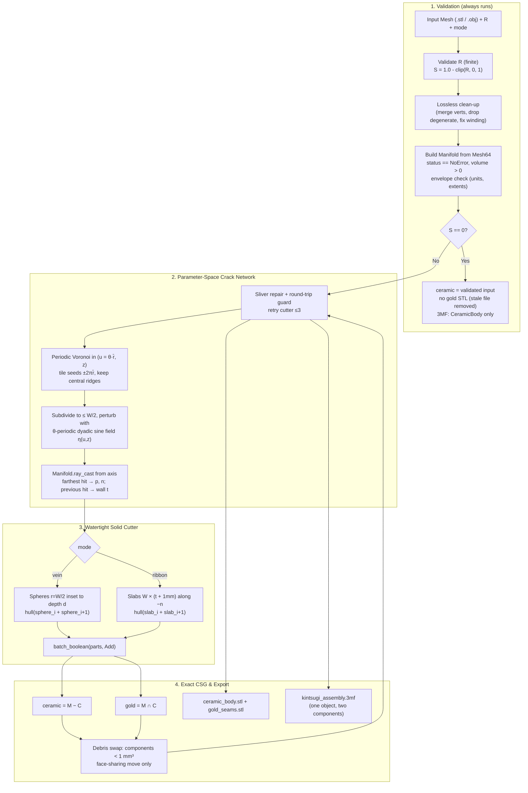

## Context

The system algorithmically fractures pristine 3D manifold vessel meshes to generate dual-material 3D printable Kintsugi assemblies. Fracture density, printable seam thickness, and vertical band extent scale with an economic inequality metric $R$. The implementation must produce physically printable, non-overlapping, watertight solids that modern slicers can ingest without geometric or file format errors.

## Supported Inputs

Scope is deliberately narrow: closed 2-manifold meshes in millimetres, +Z up, extents within $[20, 300]$ mm, whose exterior is radially star-shaped about the vertical axis through the bounding-box XY centre within the trauma band. In practice that means bowls, cups, vases and other vessels of (approximate) revolution. Anything else, a Benchy included, is rejected up front with a `ValueError`. Generalising to arbitrary meshes needs surface-intrinsic crack tracing (geodesics) and is a separate change.

## System Architecture Diagram

## Goals / Non-Goals

**Goals:**
- Provide a robust Python function `generate_kintsugi_mesh` and CLI script `kintsugi.py`.
- Guarantee watertight 2-manifold output for both ceramic and gold bodies, verified after an STL disk round-trip.
- Eliminate wall-hopping on thin-walled pottery by using cylindrical parameter space.
- Eliminate wedge gaps at bends by forming cutter segments from consecutive convex hulls in Manifold3D.
- Export both standard STL pairs and a single-object, two-part 3MF.
- Byte-identical output for identical inputs and seed.
- Provide a zero-build local Windows XP Luna-themed Web GUI (`web_app.py`) conforming to `DESIGN.md` with real-time Three.js 3D viewport, preloaded models, and one-click downloads.

**Non-Goals:**
- Real-time finite element simulation of mechanical stress fracturing.
- Meshes outside the supported input envelope (non-vessels, open or non-manifold meshes, non-mm units). These are rejected, not repaired.
- Slicer toolpath generation and per-part filament assignment metadata.

## Decisions

### Decision 1: Direct `manifold3d` CSG with fail-fast validation
- **Choice**: Use `manifold3d` directly with `Mesh64` input; validate before any branching on $R$; no perturbation retries; no hole filling.
- **Rationale**: Manifold's failure mode is non-manifold input, which vertex jitter cannot repair, and asymmetric jitter would break complementarity. `fill_holes` invents geometry and contradicts the non-goal; a mesh that needs it is out of envelope. Validating before the wealthy branch stops a broken input being exported as a "pristine" body. `Mesh64` avoids the float32 downcast of `Mesh`; conversion is a copy, not zero-copy.
- **Alternatives considered**: CGAL / OpenSCAD (rejected: slow, coplanar failures); `trimesh.boolean` wrapper (rejected: per-call conversion overhead).

### Decision 2: Unrolled cylindrical parameter space with periodic Voronoi
- **Choice**: Seed and build the crack graph in $(u, z) = (\theta\bar r, z)$, tile seeds at $u \pm 2\pi\bar r$ for periodicity, keep only ridges (finite or unbounded) with at least one central-tile seed, shift finite ridges by $\pm 2\pi\bar r$ to recover seam-crossing fragments, perturb with a $\theta$-periodic, position-only noise field, and project by radial ray cast taking the farthest hit.
- **Rationale**:
  - Raw $(\theta, z)$ mixes radians with millimetres, which squashes cells horizontally on wide vessels; unrolling by $\bar r$ makes cell shapes roughly isotropic on the surface.
  - `scipy.spatial.Voronoi` is not periodic, so tiling is needed to avoid a visible seam at $\theta = 0$.
  - A 3-tile strip is not periodic at its ends. A finite ridge whose two seeds both sit in the −1 or +1 tile is bent by the neighbour that would sit one tile farther out; shifting that bent copy into the central tile creates a phantom ridge. Requiring a central seed for every ridge removes this distortion; any real seam-crossing ridge already has a periodic copy with a central seed.
  - **Invariant:** before the noise field is applied, every emitted point lies on the true periodic Voronoi diagram. Tiling, central-seed filtering, clipping, ridge-aligned jitter and wall truncation must all preserve that invariant.
  - Noise must be periodic in $\theta$ (integer angular frequencies) for the same reason, and must depend only on position so that shared junctions stay connected.
  - Voronoi ridges are 2-point segments, so they must be subdivided before perturbation or the noise has nothing to bend.
  - The ray from the axis hits the inner wall first; the farthest hit is the exterior, and the gap to the previous hit gives local wall thickness $t$ for free. That value sizes ribbon depth and caps vein depth.
- **Crack terminals**: The band-edge terminal is moved *along its ridge* by clipping the raw ridge at a per-terminal limit $z_{edge} + \delta$, rather than adding a vertical offset. At the wall range, the polyline is truncated at the crossing point instead of projecting points onto a horizontal clamp line. Projecting points onto a line destroys the pre-noise diagram invariant and turns independent crack ends into collinear runs that can cross or tangle.
- **Alternatives considered**: 3D nearest-surface projection (rejected: wall-hopping); geodesic tracing with potpourri3d (deferred: needed only beyond the vessel envelope); `trimesh` ray casting (rejected: needs `rtree`, which is not installed; `Manifold.ray_cast` is native and exact).

### Decision 3: Consecutive convex hulls for the cutter
- **Choice**: Ribbon uses `(section_i + section_{i+1}).hull()` per segment, one `batch_boolean` union per cutter. Vein unions overlapping inset spheres directly (and uses a hull only when a consecutive-centre gap exceeds the sphere diameter). Ribbon slabs use the frame $(T, b = T \times n, n)$ with $T$ projected onto the tangent plane; vein spheres are inset so the groove depth is $d = \min(0.75W, 0.5t)$ rather than the $W/2$ a surface-centred sphere would give.
- **Rationale**: Hulls of consecutive **non-overlapping** ribbon sections bridge joints without wedge gaps. For vein, the path step is at most $W/2$ and the radius is $W/2$, so spheres already overlap; hulling already-overlapping spheres creates shared faces that kiss after STL rounding. A sub-0.3% per-sphere radius jitter prevents exactly tangent surfaces. The frame comes from the surface normal at every point, not from parallel transport, so there is no accumulated twist. Ribbon depth $t + 1$ mm guarantees a clean through-cut without reaching the opposite side of the vessel.

### Decision 4: Debris swap instead of deletion
- **Choice**: Components below $1\text{ mm}^3$ are moved into the other output only when unioning them reduces the destination's connected-component count, i.e. they share a face region. Crumbs that touch only at an edge or point stay in their original material and increment `debris_unmoved`.
- **Rationale**: Deleting breaks complementarity and leaves voids. Swapping keeps the assembly solid. An unconditional union can create new kissing edges when the contact is only an edge or a point, so the face-sharing test is required for watertight exports. Gold debris at grazing rim exits is the more common case and was previously unhandled.
- **Known limit**: Volume filtering cannot see thin needles attached to larger shards; the printable-thickness test bounds those.

### Decision 5: Hand-written 3MF with components
- **Choice**: Write the 3MF Core XML directly: one build item → one parent object → `<components>` referencing `CeramicBody` and `GoldSeams` mesh objects.
- **Rationale**: `trimesh.Scene.export(file_type="3mf")` writes two independent build items (verified), which slicers load as two separate objects that can be auto-arranged apart. Components load as one object with two parts. Writing it by hand also drops the `lxml` and `networkx` dependencies.

### Decision 6: No gold STL in the wealthy state
- **Choice**: For $R \ge 1.0$, skip `gold_seams.stl`, remove any stale file at that path, and return `gold_path: None`.
- **Rationale**: Every alternative is worse. An empty STL is rejected by trimesh and likely by slicers. A "minimal non-interfering marker" is a real object that would be printed as a gold speck on a piece whose meaning is *no* fracture.

### Decision 7: Cutter de-alignment, export repair and round-trip guard
- **Choice**: Never perturb the validated input mesh. Perturb only the cutter: each unique vein sphere is randomly rotated with a `≤0.2%` radius jitter and overlapping spheres are unioned directly; each ribbon slab gets a seeded ±0.5° rotation about its normal plus `≤10^-3·W` depth/centre jitter. All cutter randomness uses dedicated sub-seeds derived from `[seed, 0xC07, attempt]`. The guard computes the repaired trimesh for each material **once per guard evaluation** (the repair ran on 15% of exported meshes in a fresh sweep) and reuses those meshes for the STL, the 3MF and the triangle counts. Sub-`10 nm` sliver edges are collapsed only when the mesh remains watertight, positive-volume and within `10^-6` relative volume. After the debris swap, both outputs are serialised to binary STL in memory and reloaded with position merging; both must have zero edges used by ≠2 faces. On failure, rebuild only the cutter for up to 3 attempts (vein mode may try two deterministic union orders within one attempt); if all fail, raise `RuntimeError` and write nothing.
- **Rationale**: STL position-merging is the reference check because it reproduces the slicer/loader behaviour that exposes kissing vertices. Perturbing the input would break complementarity and move printable geometry; rotating or jittering the cutter preserves both booleans on the same solid while breaking coincident tessellation. The actual out-of-sample failures were sub-`10 nm` CSG slivers that float32 STL turned into four-face edges; a guarded edge collapse removes those deterministically, so the retry guard is a backstop rather than routine work. Reusing the repaired mesh avoids repeating an expensive repair; the sweep median/max run times are recorded in `verification.md §11`. The retry limit bounds worst-case latency and keeps determinism.

### Decision 8: Retro Windows XP Web GUI & Zero-Build Architecture
- **Choice**: Implement a local web GUI in FastAPI + vanilla HTML5/CSS/JavaScript with CDN-hosted Three.js, styled strictly after the tokens in `DESIGN.md`.
- **Rationale**: Eliminates frontend build toolchains (Node/npm/webpack) so any user or robot rig operator can launch it instantly with `python web_app.py`. The retro Windows XP Luna theme provides a tactile, nostalgic aesthetic while the Three.js viewport provides high-fidelity PBR rendering (matte porcelain and metallic gold) for 3D inspection before printing.
- **Upload-cap caveat**: The 50 MB cap is enforced while `_save_upload` copies the upload to disk, but Starlette has already spooled the request body by then. It is a storage/abuse cap, not a true network request-size guard; a network-exposed deployment should add a reverse-proxy limit in front of uvicorn.

## Risks / Trade-offs

- **[Risk] Inputs that are almost vessels** (handles, spouts, flared lips that overhang the band) → **Mitigation**: farthest-hit projection handles lips; handles produce ray-hit gaps that split paths; above 5% misses the input is rejected rather than silently mangled.
- **[Risk] Cutter size and boolean time** → **Mitigation**: `circular_segments=16` and subdivision at $W/2$. Time and triangle budgets are *measured* in `generate_sample.py` and recorded in `verification.md`, not asserted up front. A 400-capsule cutter subtracted from a sphere already yields about 157k output triangles.
- **[Risk] Material bond** across the ceramic/gold interface in ribbon mode, where shards are held only by gold → **Mitigation**: documented as an unverified assumption; requires a physical print test with same-polymer filaments (PLA + silk PLA).
