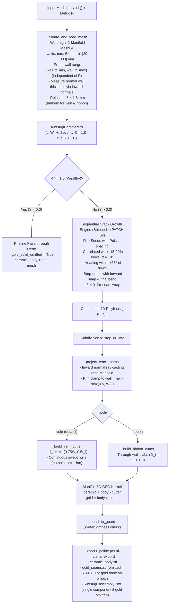

> [!NOTE]
> This document specifies **technical system architecture only** (data flow, storage, APIs, concurrency, state synchronization, and security).
> All visual, aesthetic, and UI design decisions (colors, typography, component styling, responsive layout) must be defined in `design.md`.

## Context

The Kintsugi fracture engine fractures 3D vessel meshes driven by economic disparity $R$. The previous engine attempted to support sub-millimeter vase-mode vessels ($t < 1.0\text{ mm}$). Chasing a $0.8\text{ mm}$ ceramic backing on thin walls forced vein depth formula $d = t - 0.8\text{ mm}$, causing $d \to 0$. This introduced tangent cutter contact ("kissing bug"), requiring an artificial $0.25\text{ mm}$ cutoff that omitted all cutter points on thin models like `thin_cylinder`, creating empty 84-byte gold STL files and misleading UI states. Furthermore, spiral vase mode is physically incompatible with multi-material toolheads on FDM slicers.

Restricting the engine's supported envelope to $p_5 \ge 1.6\text{ mm}$ measured along inward surface normals across the full wall range `[wall_z_min, wall_z_max]` ensures that nominal ceramic backing is $\ge 0.5 \cdot t_i$ everywhere and $\ge 0.8\text{ mm}$ wherever $t_i \ge 1.6\text{ mm}$ under $d_i = \min(0.75W, 0.5t_i)$. This eliminates the root cause of cutter point omissions and empty-gold files on supported vessels while restoring bold, continuous gold veins.

## System Architecture Diagram

## Goals / Non-Goals

**Goals:**
- **Ceramic Envelope Enforcement ($p_5 \ge 1.6\text{ mm}$)**: Preflight validation of normal wall thickness across `[wall_z_min, wall_z_max]`, rejecting sub-millimeter shells with an informative `ValueError` before any fracture operations begin, uniformly across all modes.
- **Inward Normal Thickness Probing**: Cast rays along the inward surface normal $-n_i$ from the exterior surface hit to measure true orthogonal wall thickness, avoiding flared-wall radial overestimation.
- **Continuous, Deep Gold Veins**: Restore $d_i = \min(0.75W, 0.5t_i)$, eliminating cutter point omission (`d < 0.25 mm`), polyline splitting (`_vein_point_groups`), and partial groove fading.
- **Accurately Stated Backing Guarantee**: Nominal backing is $t_i - d_i \ge 0.5 \cdot t_i$ everywhere, and $\ge 0.8\text{ mm}$ wherever $t_i \ge 1.6\text{ mm}$. Minimum groove depth is $\min(0.75 \times 0.8, 0.5 \times 1.6) = 0.6\text{ mm}$, preventing tangency.
- **Rim Lip Protection**: Clamp rim crack projection at $z = \text{wall\_z\_max} - \max(0.5, W/2)$ to avoid tapered rounded lips.
- **Preset & UI Cleanup**: Remove `thin_cylinder` from presets and `/api/presets`; remove stale "wall thickness < 1.05 mm" UI text.
- **Codify & Test PATCH-02 Morphology**: Document and regression test final-attempt near-miss snapping directly to target segments and 15–20% kink probability.
- **Reconciled Multi-Material Export**: Formalize fallback behavior when $R < 1.0$ and gold boolean is empty.

**Non-Goals:**
- Supporting single-perimeter spiral vase mode prints (physically incompatible with dual-material inlays).
- Dynamically inflating or thickening sub-1.6 mm meshes during ingestion.
- Exposing legacy Voronoi generator in user-facing GUI.
- Adding third-party graph dependencies (`networkx`).

## Technical Decisions

### Decision 1: Preflight Inward-Normal Wall Thickness Probing over Wall Range
- **Chosen**: In `validate_and_load_mesh`, reuse the preflight probe rays across the R-independent wall range `[wall_z_min, wall_z_max]`. From each exterior surface hit $p_i$ with normal $n_i$, cast an inward ray along $-n_i$ into the manifold to find the interior surface hit. The 5th percentile $p_5$ of these inward normal distances must be $\ge 1.6\text{ mm}$. If $p_5 < 1.6\text{ mm}$, raise `ValueError(f"Input vessel wall thickness (5th percentile: {p5:.2f} mm) is below the minimum ceramic envelope requirement of 1.60 mm.")`.
- **Rationale**: Measuring along the inward surface normal measures true orthogonal wall thickness. Radial horizontal rays overstate thickness on flared vessel walls by $1/\cos(\text{flare})$; at a $45^\circ$ flare, a 1.2 mm wall reads as 1.7 mm radially and would falsely pass. Inward normal probing eliminates this loophole. Evaluating over `[wall_z_min, wall_z_max]` ensures validation is independent of $R$ and works identically during `/api/validate`.

### Decision 2: Classical Continuous Vein Depth Formula
- **Chosen**: Set $d_i = \min(0.75W, 0.5t_i)$ along all cutter points, where $t_i$ is normal wall thickness. Remove `GROWTH_MIN_DEPTH_MM`, `_vein_point_groups`, and path splitting logic. Clamp rim projection at $z = \text{wall\_z\_max} - \max(0.5, W/2)$.
- **Rationale**: Nominal ceramic backing is $t_i - d_i \ge 0.5 \cdot t_i$ everywhere, and $\ge 0.8\text{ mm}$ wherever $t_i \ge 1.6\text{ mm}$. For all valid runs ($W \in [0.8, 2.2]\text{ mm}$), minimum depth is $0.6\text{ mm} \gg 0.25\text{ mm}$, so cutter spheres are always deeply embedded without tangency risk.

### Decision 3: Crack Growth Snapping & Morphology Regression Gating
- **Chosen**: Keep the PATCH-02 growth algorithm (`f77406d` on `main`) and add regression unit tests:
  - Advancing segments within clearance $R_{\text{clear}} = W + 0.8\text{ mm}$ project forward to the earliest hit segment and split it with a shared vertex.
  - If forward projection cannot reach, on the final attempt the step bends directly onto the nearest point on the hit segment if arrival angle $\ge 30^\circ$ and the bent segment is collision-free.
  - Sharp kink probability is 20%, with remaining steps sampled from Gaussian $\sigma = 18^\circ$.
- **Rationale**: Verified in sweeps with 0 crossings across 1,200 seeds; regression tests ensure this behavior does not regress during envelope refactoring.

### Decision 4: Exporter Defensive Safeguards & UI Consistency
- **Chosen**: In `kintsugi.py`, `_gold_solid_omitted` logic handles cases where the gold solid has zero volume or triangles. In `web_app.py` and `viewer.js`, when $R \ge 1.0$ the UI shows `Pristine / Wealthy (0 cracks)`. When $R < 1.0$ and seams are omitted, the UI shows `Seams Omitted` cleanly without stale sub-millimeter thickness strings.
- **Rationale**: Reconciles the multi-material export contract with runtime booleans cleanly.

## Risks / Trade-offs

- **[Risk] Normal ray cast returns no interior hit (e.g. at solid base or rim lip)** → *Mitigation*: Fall back to radial thickness or skip unclosed probe rays when computing $p_5$, requiring at least 95% of probe rays to return valid interior hits across the wall range.
- **[Risk] Tessellated boundary test fragility** → *Mitigation*: Test envelope acceptance on a synthesized cylinder with wall thickness $\approx 1.7\text{ mm}$ and rejection on a cylinder with wall thickness $\approx 1.5\text{ mm}$. Test the exact boundary comparison ($p_5 \ge 1.60$) directly in a unit test of the comparison helper.

## Migration & Rollback Plan

- **Deployment**: Single commit updating `kintsugi.py`, `sample_models.py`, `web_app.py`, test fixtures, and scripts.
- **Rollback**: Git revert restores prior commit if unexpected regressions occur.
