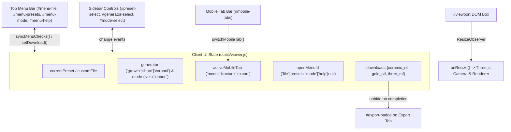

> [!NOTE]
> This document specifies **technical system architecture only** (data flow, storage, APIs, concurrency, state synchronization, and security).
> All visual, aesthetic, and UI design decisions (colors, typography, component styling, responsive layout) must be defined in `design.md`.

## Context

Kintsugi Studio 2001 is a single-page Three.js + FastAPI application (`static/index.html`, `static/xp.css`, `static/viewer.js`, `web_app.py`). Currently, its top `<nav class="menu-bar">` only calls `.focus()` on form inputs, and its mobile layout (`@media (max-width: 900px)`) stacks four tall form panels above the 3D viewport without tab partitioning or `ResizeObserver` canvas synchronization.

This change introduces a client-side menu controller, a mobile tab state controller, bidirectional state synchronization between the menu bar and sidebar controls, and a `ResizeObserver` on `#viewport`—requiring zero backend API changes or external JS/CSS dependencies.

## Target Context Map

| File Path (Relative to Repo Root) | Target Lines | Modification Summary |
| :--- | :--- | :--- |
| `static/index.html` | `L30-L127` | Replace static `.menu-bar` buttons with `.menu-entry` + `.menu-dropdown` containers (`#menu-file`, `#menu-presets`, `#menu-mode`, `#menu-help`), add `#mobile-tabs` (`model`, `fracture`, `export` with `#export-badge`) inside `<aside class="sidebar">`, tag `.panel` elements with `data-tab-panel="model|fracture|export"`, and add `#help-dialog` modal inside `.window`. |
| `static/xp.css` | `L75-L113, L190-L498, L612-L682` | Add `.menu-entry`, `.menu-dropdown`, `.menu-option`, `.menu-separator`, `.menu-section-label`, `.mobile-tabs`, `.mobile-tab`, `.tab-badge`, and `.xp-dialog` rules; update `@media (max-width: 900px)` for `100dvh`, `order: -1` on `.viewport-shell`, `[data-tab-panel]` visibility toggling, `font-size: 16px` inputs, $\ge 40\text{px}$ touch targets, and sticky `#fracture-button`. |
| `static/viewer.js` | `L19-L43, L119-L134, L238-L295, L460-L530` | Add `ResizeObserver` on `ui.viewport`; implement `switchMobileTab(tabName)`, `openMenu(name)`, `closeMenus()`, `syncMenuChecks()`, dynamic `#menu-presets` population in `loadPresets()`, `File` menu download link synchronization in `setDownload()`, `#export-badge` notification on fracture completion, and `#help-dialog` open/close handlers. |
| `tests/test_web_api.py` | `L49-L75` | Add `test_mobile_ui_and_menus_markup_served` verifying `GET /`, `GET /xp.css`, and `GET /viewer.js` serve all required menu, tab, `100dvh`, and `ResizeObserver` bindings. |

## System Architecture Diagram

## Goals / Non-Goals

**Goals:**
- Provide functional dropdown menus (`File`, `Presets`, `Mode`, `Help`) in `<nav class="menu-bar">` synchronized bidirectionally with the sidebar controls and download state.
- Ensure the 3D viewport stays pinned at the top of the screen on mobile viewports (`<= 900px`) while users switch between `Model`, `Fracture`, and `Export` tabs below.
- Automatically resize the Three.js WebGL canvas via `ResizeObserver` whenever mobile tabs, orientation, or dynamic browser toolbars alter `#viewport` dimensions.
- Prevent iOS Safari input auto-zoom and page-scroll vs. 3D-orbit gesture conflicts.

**Non-Goals:**
- Modifying backend FastAPI routes in `web_app.py` or geometry generation in `kintsugi.py`.
- Introducing external frontend frameworks, build steps, or CSS libraries.

## Technical Decisions

### 1. Bidirectional Menu & Control Synchronization (`syncMenuChecks`)
- **Decision**: Keep existing `<select id="preset-select">`, `<select id="generator-select">`, and `<input name="mode">` elements as the canonical form controls read by `fracture()`, and synchronize the `Presets` and `Mode` dropdown menu items via a single `syncMenuChecks()` helper called whenever preset, generator, or mode changes.
- **Rationale**: Avoids duplicating state variables or changing how `fracture()` builds its `FormData` payload, while allowing users to switch presets, generators, or modes seamlessly from either the top menu bar or the sidebar panels.

### 2. CSS-Driven Responsive Tab Partitioning (`data-tab-panel`)
- **Decision**: Mark each `.panel` in `static/index.html` with `data-tab-panel="model"`, `data-tab-panel="fracture"`, or `data-tab-panel="export"`, and toggle `.mobile-panel-active` via `switchMobileTab(tabName)`. Scope `.panel[data-tab-panel]:not(.mobile-panel-active) { display: none; }` strictly inside `@media (max-width: 900px)`.
- **Rationale**: On desktop (`> 900px`), all four panels remain simultaneously visible in the left sidebar with zero layout change; on mobile (`<= 900px`), only the active tab's panel(s) render below the pinned 3D viewport, eliminating vertical scroll clutter.

### 3. `ResizeObserver` on `#viewport`
- **Decision**: Attach `new ResizeObserver(() => onResize()).observe(ui.viewport)` inside `initViewer()` (guarded by `typeof ResizeObserver !== "undefined"`).
- **Rationale**: `window` `"resize"` events do not fire when internal flex/grid children change height (such as switching mobile tabs or toggling maximized window state). Observing `ui.viewport` directly guarantees crisp, unstretched WebGL rendering at all times.

## Risks / Trade-offs

- **[Risk] Open dropdown menu remains visible when tapping into the 3D canvas** → **Mitigation**: Listen for `pointerdown` on `document` outside `.menu-entry` (including on `#viewport` canvas) and `keydown` `Escape` to immediately call `closeMenus()`.
- **[Risk] User on mobile `Fracture` tab does not notice completed downloads on `Export` tab** → **Mitigation**: Unhide `#export-badge` (`●`) on the `Export` tab button when `fracture()` completes, and also mirror all three download links inside `File` $\to$ `Download ...` in the top menu bar.

## Migration & Rollback Plan

- Pure static frontend update (`static/index.html`, `static/xp.css`, `static/viewer.js`); all existing DOM IDs (`#preset-select`, `#generator-select`, `#mode-select`, `#ratio-slider`, `#fracture-button`, `#download-*`) are preserved.
