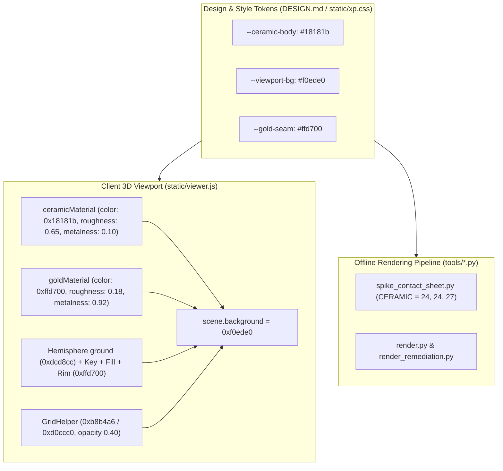

> [!NOTE]
> This document specifies **technical system architecture only** (data flow, storage, APIs, concurrency, state synchronization, and security).
> All visual, aesthetic, and UI design decisions (colors, typography, component styling, responsive layout) must be defined in `design.md`.

## Context

Kintsugi Studio 2001 renders 3D vessels in a Three.js WebGL canvas inside an inset viewport well on the desktop interface (`static/index.html`, `static/xp.css`, `static/viewer.js`). Offline verification scripts (`tools/spike_contact_sheet.py`, `tools/render.py`, `tools/render_remediation.py`) generate standalone visual contact sheets comparing fracture severity and seed variations.

This change coordinates the PBR material attributes, scene background, lighting parameters, and offline render color constants to transition from an off-white vessel on dark slate to a Kuro-raku matte black vessel on a gallery off-white well with lustrous gold seams.

## Target Context Map

| File Path (Relative to Repo Root) | Target Lines | Modification Summary |
| :--- | :--- | :--- |
| `static/viewer.js` | `L71-L76, L97, L114-L115, L133-L138` | Update `ceramicMaterial` PBR parameters (`color: 0x18181b`, `roughness: 0.65`, `metalness: 0.10`); update `scene.background = new THREE.Color(0xf0ede0)`; set hemisphere ground light to warm neutral `0xdcd8cc`; adjust `GridHelper` lines to `0xb8b4a6` / `0xd0ccc0` with `0.40` opacity. |
| `static/xp.css` | `L28-L32` | Update `--viewport-bg: #f0ede0;` and `--ceramic-body: #18181b;`. |
| `DESIGN.md` | `L39-L43, L136-L139` | Update design tokens for `viewport-bg`, `ceramic-body`, and material design philosophy. |
| `openspec/specs/retro-web-gui/spec.md` | `L18` | Update 3D viewport inspection scenario to reflect Kuro-raku black ceramic and gallery off-white viewport canvas. |
| `tools/spike_contact_sheet.py` | `L34-L37` | Update `CERAMIC` tuple from `(235, 230, 218)` to `(24, 24, 27)` (`#18181b`). |
| `tools/render.py` | `L112-L114` | Update `CERAMIC` tuple from `(235, 230, 218)` to `(24, 24, 27)`. |
| `tools/render_remediation.py` | `L111-L113` | Update `CERAMIC` tuple from `(235, 230, 218)` to `(24, 24, 27)`. |
| `tests/test_web_api.py` | `L280-L295` | Add assertions checking that `GET /xp.css` serves `--ceramic-body: #18181b` and `--viewport-bg: #f0ede0`, and `GET /viewer.js` serves `0x18181b` and `0xf0ede0`. |

## System Architecture Diagram

## Goals / Non-Goals

**Goals:**
- Provide clear visual separation and silhouette clarity for 3D vessels by setting `scene.background` to gallery off-white (`0xf0ede0`) and `ceramicMaterial` to Kuro-raku matte black (`0x18181b`).
- Keep gold seams (`#ffd700`) completely unchanged and bright with high specular reflectivity (`roughness: 0.18`, `metalness: 0.92`).
- Tune viewport directional/hemisphere lighting and drafting grid helper so the black vessel contours and grid lines look crisp on a light canvas.
- Maintain 100% color consistency between the Web GUI and the offline rendering tools (`tools/spike_contact_sheet.py`, `tools/render.py`).

**Non-Goals:**
- Altering the backend geometry generation pipeline, mesh boolean logic, or STL/3MF file export bytes.
- Modifying UI window frame colors outside the 3D viewport well (`--surface` remains `#ece9d8`).
- Introducing dynamic user color-picker controls.

## Technical Decisions

### 1. PBR Specular Roughness on Kuro-Raku Black (`roughness: 0.65`, `metalness: 0.10`)
- **Decision**: Set `roughness: 0.65` and `metalness: 0.10` on `ceramicMaterial` rather than pure matte diffuse (`roughness: 0.85`, `metalness: 0.05`).
- **Rationale**: A dark charcoal/black surface with pure diffuse reflection looks completely flat. Slight specular reflection allows the Three.js directional lights (`key`, `fill`, `rim`) to catch the curved lip, rim, and foot of the vessel, revealing 3D form and curvature.
- **Alternative considered**: Pure pitch black `0x000000`. Rejected because it completely flattens 3D geometry into silhouettes.

### 2. Gallery Off-White Background (`0xf0ede0`) Matching Inset Well
- **Decision**: Set `scene.background = new THREE.Color(0xf0ede0)` and `--viewport-bg: #f0ede0`.
- **Rationale**: `#f0ede0` matches the CSS `--surface-inset` token used for inset wells and upload zones, providing a warm off-white canvas that makes dark vessels pop while remaining harmonious with the surrounding Windows XP `#ece9d8` chassis.
- **Alternative considered**: Stark white `#ffffff`. Rejected because stark white creates harsh glare inside the retro Windows XP window body.

### 3. Synchronizing Offline Contact Sheets (`CERAMIC = (24, 24, 27)`)
- **Decision**: Update `CERAMIC` tuple in `tools/spike_contact_sheet.py`, `tools/render.py`, and `tools/render_remediation.py` from `(235, 230, 218)` to `(24, 24, 27)` (`#18181b`).
- **Rationale**: Contact sheet figures have white backgrounds; updating the ceramic tuple ensures generated audit figures match the real-time Web GUI display.

## Risks / Trade-offs

- **[Risk] Black vessel interior appears too dark during orbit inspection** → **Mitigation**: The directional fill light (`0x9fc6ff`, 1.0) and key light (`0xfff4df`, 2.5) illuminate interior vessel cavities, and the hemisphere light ground bounce is raised to warm neutral `0xdcd8cc` to provide soft ambient fill inside hollow vessels.

## Migration & Rollback Plan

- **Deployment**: Pure static frontend and tool script update. Zero database, backend route, or geometry changes.
- **Rollback**: Reverting the hex values to `#f8f6f0` and `#1a1f2c` immediately restores the porcelain white appearance.
