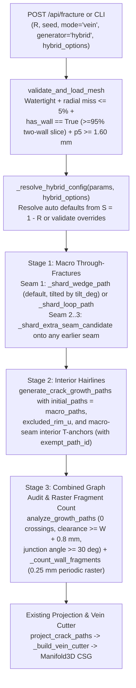

> [!NOTE]
> This document specifies **technical system architecture only** (data flow, storage, APIs, concurrency, state synchronization, and security).
> All visual, aesthetic, and UI design decisions (colors, typography, component styling, responsive layout) must be defined in `design.md`.

## Context

`kintsugi.py` currently implements two primary parameter-space crack generators in unrolled cylindrical coordinates `(u, z)`:
1. `generate_crack_growth_paths` (`kintsugi.py:1313`): sequentially grows rim-seeded trunks and branches using `_first_growth_collision` (`kintsugi.py:1121`) for stop-on-hit T-junction snapping and clearance enforcement.
2. `generate_shard_crack_paths` (`kintsugi.py:2585`): synthesizes 1–2 macro shard seams (an open rim-to-rim wedge or closed tilted loop, plus an optional second rim-to-seam wedge via `_shard_second_seam_candidate` at `kintsugi.py:2453`).

Both generators feed the exact same downstream 3D surface projection (`project_crack_paths`), vein cutter construction (`_build_vein_cutter`), and Manifold3D boolean carving pipeline. The hybrid generator (`generate_hybrid_crack_paths`) composes Stage 1 (macro shard through-fractures) and Stage 2 (interior growth hairlines) into a single validated planar graph in `(u, z)` space before projection. Because `hybrid` operates in `vein` mode only, its seams visually and topologically partition the exterior wall surface map (`num_fragments >= 2` for $S \ge 0.2$) while `ceramic_body.stl` remains a single connected solid.

## System Architecture Diagram

## Goals / Non-Goals

**Goals:**
- Guarantee that every hybrid fracture with $S \ge 0.2$ partitions the exterior vessel wall surface into at least 2 connected regions (`num_fragments >= 2` and `num_through_fragments >= 2`, measured by a `0.25 mm` periodic raster connected-component pass) via 1–3 macro through-fractures, with Seam 1 defaulting to an edge-reaching rim-to-rim wedge when `through_shape="auto"`.
- Make `tilt_deg` steer both `_shard_wedge_path` (nadir depth and longitudinal skew) and `_shard_loop_path` (loop plane inclination) so `tilt_deg` is active under every `through_shape`.
- Reuse `_first_growth_collision` by passing Stage-1 macro paths as pre-committed obstacles into `generate_crack_growth_paths`, and seed Stage-2 primary hairline trunks (`hairline_count`) from both rim seeds (spaced clear of Stage-1 rim crossings in both rejection sampling and gap fallback) and interior anchors along Stage-1 macro seams (with `exempt_path_id` and `exempt_origin` set so their first step does not collide with the parent macro seam).
- Expose 6 hybrid-only knobs (`through_count`, `through_shape`, `tilt_deg`, `hairline_count`, `hairline_reach`, `roughness`) with `auto` defaults derived from $S = 1 - R$, echoing resolved values in `parameters["hybrid"]` and rejecting hybrid knobs on non-`hybrid` generators with `ValueError` / `HTTP 400`.
- Enforce `has_wall == True` inside `validate_and_load_mesh` globally so solid bodies without an interior cavity fail at validation time.
- Preserve byte-identical output for `generator="growth"`, `"shard"`, and `"voronoi"`, verified against pre-change SHA-256 path digests.

**Non-Goals:**
- Supporting `mode="ribbon"` for `generator="hybrid"` or physically splitting `ceramic_body.stl` into multiple disconnected solid bodies.
- Adding new controls for plain `generator="shard"`.
- Changing the default generator from `"growth"` before visual sign-off.

## Technical Decisions

### 1. Pre-Committed Obstacle Paths in `generate_crack_growth_paths` (`kintsugi.py:1313`)
- **Decision**: Extend `generate_crack_growth_paths` with keyword-only arguments:
  - `initial_paths: list[np.ndarray] | None = None`
  - `initial_junctions: list[dict] | None = None`
  - `excluded_rim_u: Sequence[float] = ()`
  - `hairline_count: int | None = None`
  - `hairline_reach: float | None = None`
  - `roughness_scale: float = 1.0`
  - `seam_anchor_count: int = 0`
- **Rationale**: When all keyword arguments are at their defaults (`None` / `()` / `1.0` / `0`), `generate_crack_growth_paths` consumes the exact same RNG sequence and produces byte-identical paths to today's `growth` generator. When invoked by `generate_hybrid_crack_paths`, `paths` is initialized with copies of the Stage-1 macro polylines (`[ [np.asarray(pt, dtype=np.float64).copy() for pt in p] for p in initial_paths ]`) and `junction_records` with `initial_junctions`. Every subsequent growth step calls `_first_growth_collision(paths, ...)`, which automatically treats Stage-1 seams (and their periodic copies $\pm P$) as committed obstacles—snapping into verified $\ge 30^\circ$ T-junctions and subdividing the hit macro seam in-place.

### 2. Generalizing Seam 2/3 T-Junction Search (`_shard_extra_seam_candidate`, `kintsugi.py:2453`) & Making `tilt_deg` Steer Wedges (`kintsugi.py:2297`)
- **Decision**:
  1. Factor `_shard_second_seam_candidate` into `_shard_extra_seam_candidate(params, rng, existing_paths, attempt_index)` so Seam $k \in \{2, 3\}$ targets `existing_paths[attempt_index % len(existing_paths)]`, evaluates `_shard_first_intersection` across **all** paths in `existing_paths`, and truncates at the earliest hit `(candidate_index, t)`. Keep `_shard_second_seam_candidate(params, rng, seam1, attempt_index)` untouched for `generate_shard_crack_paths`.
  2. When `generate_hybrid_crack_paths` calls `_shard_wedge_path(params, rng, config, *, apply_tilt=True, roughness_scale=1.0)`, `tilt_deg = float(config["tilt_deg"])` ($\in [5.0, 30.0]$) steers both the wedge's nadir depth and its longitudinal skew:
     - Let $\tau_{\text{norm}} = \text{clip}((\text{tilt\_deg} - 5.0) / 25.0, 0.0, 1.0)$. The nadir band shifts deeper with higher tilt: $z_{\text{nadir}} = \text{nadir\_hi} - (0.35 + 0.65\,\tau_{\text{norm}})(\text{nadir\_hi} - \text{nadir\_lo}) + \text{jitter}$, and the normalized parameter $t \in [0, 1]$ is warped by $t_{\text{skew}} = t^{\,1.0 + 0.35(\tau_{\text{norm}} - 0.5)}$ before computing $\sin(\pi t_{\text{skew}})^{0.85}$. Thus changing `tilt_deg` deterministically changes both the depth and slant of a `wedge` seam. When `apply_tilt=False` (default for plain `shard`), `_shard_wedge_path` runs its existing code path unchanged.

### 3. Rim + Macro-Seam Hairline Nucleation with `exempt_path_id` / `exempt_origin`
- **Decision**:
  - `hairline_count` defines the number of primary Stage-2 hairline trunks (`level=0` growth tasks). Its `auto` default uses the named tier table: `0` for $S < 0.20$, `3` for $0.20 \le S < 0.35$, `5` for $0.35 \le S < 0.70$, and `7` for $S \ge 0.70$.
  - For $S < 0.20$ with `through_count="auto"` and `hairline_count="auto"`, `generate_hybrid_crack_paths` returns `[]` (`through_count = 0`, `hairline_count = 0`, `num_fragments = 1`). If the user explicitly overrides `through_count >= 1` or `hairline_count >= 1` when $0 < S < 0.20$, `_shard_severity_config` falls back to the lowest tier (`harmonic = 0.015`, `kink_deg = 4.0`, `tilt_deg = 14.0`).
  - Split `hairline_count` into `n_seam_target = hairline_count // 2` interior macro-seam anchors and `n_rim_target = hairline_count - n_seam_target` rim seeds:
    - **Macro-seam anchors**: For each target anchor, candidate vertices on Stage-1 macro seams inside $[\text{wall\_z\_min} + 1.5 W, \text{wall\_z\_max} - 1.5 W]$ at distance $\ge 2 R_{\text{clear}}$ from existing endpoints and junctions are evaluated. A departure heading is drawn at $\pm U(60^\circ, 85^\circ)$ from the local seam tangent and passed through `_clamp_heading` (which restricts headings to $\pm 85^\circ$ of straight down). If the clamped heading maintains an acute angle $\ge 45^\circ$ against the seam tangent, a new path `[anchor.copy()]` is appended to `paths`, a `"T"` junction record is added to `junction_records`, and a `_GrowthTask` is enqueued with:
      - `exempt_path_id = macro_path_index`
      - `exempt_origin = anchor.copy()`
      - `budget = hairline_reach * H_wall`, `level = 0`, `steps = 0`
      Setting `exempt_path_id` and `exempt_origin` activates `_first_growth_collision`'s built-in exemption radius `1.10 * r_clear / sin(30°)` around the anchor on the parent macro seam so the first step does not self-collide. (Note: on the upper arch of a closed loop where downward-clamped headings cannot clear $45^\circ$, or when no vertex clears $2 R_{\text{clear}}$, the unplaced slot falls back to `n_rim_target`.)
    - **Rim seeds (`_poisson_rim_seeds`)**: Collect `macro_rim_u` from all Stage-1 endpoints with $z \ge \text{wall\_z\_max} - 0.5 W$. Both the rejection-sampling loop AND the deterministic largest-gap fallback loop in `_poisson_rim_seeds` enforce `all(_circular_distance(u, ex, period) >= 1.5 * r_clear for ex in excluded_u)`. In the gap fallback, only gap midpoints outside all exclusion zones and at distance $\ge \text{min\_sep}$ from existing seeds are accepted; if no such gap exists, the loop terminates early rather than placing a seed inside an exclusion zone.
  - **Roughness scaling**: In `generate_crack_growth_paths`, `delta_deg` is multiplied by `roughness_scale` (`0.5..2.0`) *before* `candidate_heading = _clamp_heading(task.heading + math.radians(delta_deg))` clamps the heading to $[-175^\circ, -5^\circ]$, keeping step length and step count unchanged.

### 4. Periodic Raster Connected-Component Fragment Count (`_count_wall_fragments`)
- **Decision**: Compute `num_through_fragments = _count_wall_fragments(macro_paths, params)` and `num_fragments = _count_wall_fragments(paths, params)` using a deterministic 2D periodic raster flood-fill on `[0, period) × [wall_z_min, wall_z_max]`:
  - Grid resolution: `step = 0.25` mm (`nu = max(32, int(round(period / 0.25)))`, `nz = max(16, int(round((wall_z_max - wall_z_min) / 0.25)))`).
  - Seam mask: cells whose center `(u_j, z_i)` lies within `0.5 * W` (in periodic `u` distance) of any polyline segment in the input path list are marked occupied.
  - Connected components: 4-connected BFS over free cells with horizontal wrap (`(j - 1) % nu`, `(j + 1) % nu`) and non-periodic vertical bounds `0 <= i < nz`.
  - Count components whose cell count is at least `2%` (`0.02`) of total free cells (returning `max(1, count)`).
  - Stage 3 also runs `analyze_growth_paths(paths, params)` directly on the union of Stage-1 and Stage-2 paths without silent path pruning; any crossing or clearance violation raises an error in tests.

### 5. Validation-Time `has_wall` Enforcement (`kintsugi.py:534`)
- **Decision**: In `validate_and_load_mesh`, check `if not bool(wall_probe.get("has_wall", True)): raise ValueError(...)` immediately after `_probe_wall_range(manifold, mesh)`.
- **Rationale**: In `_probe_wall_range` (`kintsugi.py:354-355`), `has_wall` is `True` iff at least one horizontal probe slice has `fraction >= 0.95` two-wall radial hits. Raising `ValueError` when `has_wall == False` rejects solid cylinders and blocks at validation time (`/api/validate` and `validate_and_load_mesh`) across all generators and modes.

## Risks / Trade-offs

- **[Risk] High `through_count=3` on narrow vessels may fail clearance on the 3rd macro seam** → **Mitigation**: Seam 3 evaluates up to 16 deterministic candidates and retains the 2 verified macro seams if all 16 violate clearance, while still guaranteeing `num_fragments >= 2`. `parameters["hybrid"]` echoes both the resolved `through_count` and `num_fragments`.
- **[Risk] Closed loop upper arch cannot spawn downward-clamped seam-anchored hairlines at $\ge 45^\circ$** → **Mitigation**: Unplaced seam-anchor slots automatically transfer to `n_rim_target`, so the upper arch above a loop is populated by rim-seeded hairlines descending from the upper lip, and `parameters["hybrid"]` reports both `hairline_rim_count` and `hairline_seam_count`.

## Migration & Rollback Plan

- Purely additive generator option (`generator="hybrid"`) and optional API form fields. `growth` remains the default generator, and existing callers of `generate_kintsugi_mesh` and `POST /api/fracture` are unaffected.
