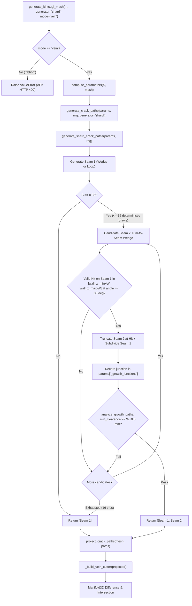

> [!NOTE]
> This document specifies **technical system architecture only** (data flow, storage, APIs, concurrency, state synchronization, and security).
> All visual, aesthetic, and UI design decisions (colors, typography, component styling, responsive layout) must be defined in `design.md`.

## Context

The Kintsugi Fracture Engine (`kintsugi.py`) generates 2D crack polylines in unwrapped cylindrical wall space `(u, z)` via `generate_crack_paths`, then projects those paths onto the 3D ceramic vessel surface (`project_crack_paths`), constructs a depth-bounded triangular prism cutter (`_build_vein_cutter`), and performs `Manifold3D` boolean difference and intersection (`generate_kintsugi_mesh`).

This change introduces an opt-in **Tilted Shard-Plane Fracture Generator (`generator="shard"`)** that synthesizes 1D exterior seam traces from tilted, roughened fracture planes in `(u, z)` space while cleanly plugging into the existing `generate_crack_paths(params, rng, *, subdivide_step=None, generator="growth")` dispatch interface and preserving all existing options (`"growth"`, `"voronoi"`).

## Target Context Map

| File Path (Relative to Repo Root) | Target Function / Symbol | Target Line Range | Planned Modification |
| :--- | :--- | :--- | :--- |
| `kintsugi.py` | `_tortuosity_values` | `L1912-L1948` | Detect closed periodic loops (`len(pts) >= 4` and `_periodic_distance(pts[0], pts[-1], P) <= 1e-6`) and split loops without junctions into 4 equal quadrant sub-arcs in 2D $(u, z)$ before computing $\text{arc}/\text{chord}$. Enforce floor $\tau \ge 1.05$. |
| `kintsugi.py` | `analyze_growth_paths` | `L1996-L2002` | Compute adjacent segment skip span cyclically (`min(abs(i-j), n_segs - abs(i-j)) <= skip_span`) when the path is a closed periodic loop. |
| `kintsugi.py` | `generate_shard_crack_paths` | `L2080-L2110` (new) | Implement shard generator accepting `(params: dict, rng: np.random.Generator, *, subdivide_step: float | None = None) -> list[np.ndarray]`. Extract $S, W, P, \bar{r}, \text{wall\_z\_min}, \text{wall\_z\_max}$ from `params`. |
| `kintsugi.py` | `generate_crack_paths` | `L2089-L2106` | Add `if generator == "shard": return generate_shard_crack_paths(params, rng, subdivide_step=subdivide_step)`. Retain `"growth"` and `"voronoi"`. |
| `kintsugi.py` | `generate_kintsugi_mesh` | `L3018-L3022` | Validate `generator in ("growth", "shard", "voronoi")`. Raise `ValueError` if `generator == "shard"` and `mode != "vein"`. |
| `kintsugi.py` | `_parse_args` | `L3270-L3276` | Add `choices=["growth", "shard", "voronoi"]` to `--generator` CLI argument. |
| `web_app.py` | `api_fracture` | `L170-L195` | Document and test that `generator="shard"` works in vein mode and that `generator="shard"` + `mode="ribbon"` returns `HTTP 400 Bad Request`. |
| `tools/spike_contact_sheet.py` | `_generate_case` & `main` | `L45-L70, L370-L400, L420-L505` | Add `--generator {growth,shard,both}`. Pass `generator` to `generate_kintsugi_mesh`. Default output to `reports/contact_sheet_shard.png` when `shard`. |
| `tests/test_crack_shard.py` | New test file | `L1-L280` | Scaffolding for TDD: open wedge truncation, closed loop drift bridge closure and cyclic clearance, verified T-junction with `_growth_junctions` metadata, quadrant sub-arc tortuosity ($\tau \ge 1.05$), `generate_kintsugi_mesh` boolean carving, and API 400 guard. |

## System Architecture Diagram



## Goals / Non-Goals

**Goals:**
- Provide an opt-in `generator="shard"` mode that synthesizes shard-like exterior seam layouts from tilted plane equations in `(u, z)` space without extra 3D solid shard boolean operations.
- Correctly map severity $S = 1 - \text{clip}(R, 0, 1)$ so that $R=0$ generates the most broken/rugged fracture and $R \ge 1.0$ generates 0 seams.
- Prevent horizontal rim/floor clamping shelves by using exact `_truncate_polyline_z` crossing truncation on open wedges and linear amplitude capping on closed loops.
- Guarantee exact closed-loop closure via linear drift bridge correction, and avoid horizontal stripe loops by falling back to Primitive A (wedge) if available wall height forces $\alpha < 5^\circ$.
- Guarantee verified inter-seam collision clearance ($\ge W + 0.8\text{ mm}$) and shared T-junction vertex insertion with `params["_growth_junctions"]` metadata exemption.
- Support closed periodic loops in `analyze_growth_paths` and `_tortuosity_values` without false wrap-point clearance errors, enforcing the 2D $(u, z)$ tortuosity floor $\tau \ge 1.05$.

**Non-Goals:**
- Splitting the ceramic body into disconnected 3D solid pieces (`mode="ribbon"` is explicitly out of scope for `generator="shard"` in Stage 1).
- Solving exact 3D plane-to-arbitrary-surface intersections during 2D path synthesis (we intentionally use the cylindrical unwrapped plane approximation followed by radial projection in `project_crack_paths`).
- Secondary hairline branches or 3rd shard planes in Stage 1 (deferred until after visual inspection of the contact sheet).

## Technical Decisions

### 1. Severity $S$ to Parameter Mapping
- **Decision**: Drive all fracture parameters from $S = 1 - \text{clip}(R, 0, 1)$:
  - $S < 0.2$ ($R > 0.8$): 0 seams.
  - $0.2 \le S < 0.35$ ($0.65 < R \le 0.8$): 1 seam, $A_{2,3} = 0.015\,\Delta z_{\text{wall}}$, $\sigma_\theta = 4^\circ$, target $\tau \in [1.05, 1.10]$.
  - $0.35 \le S < 0.70$ ($0.30 < R \le 0.65$): 1 or 2 seams, $A_{2,3} = 0.035\,\Delta z_{\text{wall}}$, $\sigma_\theta = 8^\circ$, target $\tau \in [1.08, 1.20]$.
  - $0.70 \le S \le 1.0$ ($0.0 \le R \le 0.30$): 2 seams, $A_{2,3} = 0.060\,\Delta z_{\text{wall}}$, $\sigma_\theta = 14^\circ$, target $\tau \in [1.12, 1.35]$.
  Primitive 1 selection uses `rng.uniform() < 0.5` between Wedge and Loop, unless wall height forces Wedge.

### 2. Generator Dispatch Interface & Public Entry Point
- **Decision**: Public mesh fracture function is `generate_kintsugi_mesh(..., generator="growth")`. The internal dispatcher is `generate_crack_paths(params, rng, *, subdivide_step=None, generator="growth")`. The shard generator signature is:
  ```python
  def generate_shard_crack_paths(
      params: dict,
      rng: np.random.Generator,
      *,
      subdivide_step: float | None = None,
  ) -> list[np.ndarray]:
  ```
- **Rationale**: Reuses the exact signature and parameter dictionary passed to `generate_crack_growth_paths` and `generate_crack_voronoi_paths`. Retains `"growth"`, `"shard"`, and `"voronoi"` in `generate_kintsugi_mesh`.

### 3. Loop Closure via Linear Drift Bridge & Vertical Height Capping
- **Decision**:
  - For Primitive B (Closed Tilted Loop), generate $N$ vertices with baseline tilt $z_{\text{base}}$ and Fourier harmonics ($k \in \{2, 3\}$).
  - Generate cumulative kink walk $w_i = \sum_{j=0}^i \delta_j$ with $\delta_j \sim \mathcal{N}(0, \sigma_\theta^2)$.
  - Apply linear drift bridge: $kink_i = w_i - \frac{i}{N-1}(w_{N-1} - w_0)$.
  - Cap vertical amplitudes before sampling:
    $A_{\text{avail}} = (\text{wall\_z\_max} - \text{wall\_z\_min} - 1.2 W) / 2$.
    $A_{\text{tilt}} = \min(\bar{r}\tan\alpha, 0.70 A_{\text{avail}})$, $\sum A_k \le 0.20 A_{\text{avail}}$, $\text{kink\_bound} \le 0.10 A_{\text{avail}}$.
    If $A_{\text{avail}} \le 0$ or forces $\alpha < 5^\circ$, switch to Primitive A (Wedge).
- **Rationale**: Linear drift bridge guarantees $z(0) = z(P)$ without shifting or flattening the kink statistics, and height capping prevents loops from degenerating into flat horizontal rings.

### 4. Seam 2 Geometry, `_growth_junctions` Metadata, and Fallback
- **Decision**:
  - Candidate Seam 2 is an open wedge starting at $z = \text{wall\_z\_max} + 0.35W$ at an azimuth separated by $\ge 1.5 r_{\text{clear}}$ from Seam 1 rim points.
  - Test for exact 2D segment intersection with Seam 1 in $[\text{wall\_z\_min} + W, \text{wall\_z\_max} - W]$ at arrival angle $\ge 30^\circ$.
  - Truncate Seam 2 at the hit, insert matching shared vertex into Seam 1 via `_subdivide_path`, and append to `params["_growth_junctions"]`.
  - Validate with `analyze_growth_paths`: The junction exemption radius $r_{\text{exempt}} = 1.10 r_{\text{clear}} / \sin 30^\circ$ exempts points in the acute angle near the junction while checking $r_{\text{clear}} \ge W + 0.8\text{ mm}$ everywhere else.
  - If all 16 candidate draws fail, return `[Seam 1]` and record fallback.
- **Rationale**: Prevents false clearance rejections at valid T-junctions while strictly preventing shallow grazing or intersecting secondary loops.

### 5. Closed-Loop Cyclic Clearance and Quadrant Sub-Arc Tortuosity
- **Decision**:
  - In `analyze_growth_paths`, detect closed periodic loop via `_periodic_distance(path[0], path[-1], period) <= 1e-6`. Use cyclic index distance `min(abs(i-j), n_segs - abs(i-j)) <= skip_span`.
  - In `_tortuosity_values`, split closed periodic loops without junctions into 4 equal quadrant sub-arcs by index (`[0, N//4, N//2, 3*N//4, N-1]`) in 2D $(u, z)$ before computing $\text{arc} / \text{chord}$. Enforce floor $\tau \ge 1.05$.
- **Rationale**: Prevents false clearances across the $u = 0 \equiv P$ wrap point and provides a well-defined non-zero chord of $\sim P/4$ in $(u, z)$ to measure local fracture jaggedness.

## Risks / Trade-offs

- **[Risk] High severity $S=1.0$ produces only 2 macroscopic seams compared to 15–20 growth cracks** → **Mitigation**: Documented in `design.md` that Stage 1 focuses on macroscopic shard silhouette boundaries; secondary hairlines are planned for Stage 2.
- **[Risk] Candidate Seam 2 fails 16 intersection draws on narrow wall bands** → **Mitigation**: Deterministic fallback to 1 seam ensures reliable, watertight generation without pipeline crashes.

## Migration & Rollback Plan

- `generator="growth"` remains default.
- Rollback involves reverting `generator="shard"` dispatch in `generate_crack_paths` without affecting `"growth"` or `"voronoi"`.
