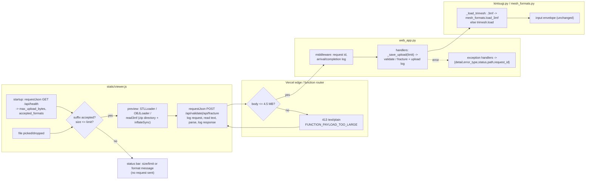

> [!NOTE]
> This document specifies **technical system architecture only** (data flow, storage, APIs, concurrency, state synchronization, and security).
> All visual, aesthetic, and UI design decisions (colors, typography, component styling, responsive layout) must be defined in `design.md`.

## Context

Uploads travel browser → Vercel edge → Python function (`app.py` → `web_app.app`) → `kintsugi.validate_and_load_mesh`. Today:

- **The platform rejects large bodies itself.** Over the Functions limit (4.5 MB), Vercel answers 413 `FUNCTION_PAYLOAD_TOO_LARGE` in plain text, and the browser's `response.json()` throws "JSON parse error". Locally there is no platform layer, and the app's own 50 MB cap applies.
- **Some app errors aren't JSON.** Unhandled exceptions return Starlette's plain-text 500.
- **Formats are fixed.** `.stl`/`.obj` are hard-coded in three places (`index.html` `accept`, `_resolve_input`, `api_validate`). The engine loads everything through `_load_trimesh` (`kintsugi.py:253`).

PR #10 (`e055b34`) already contains a working version of the diagnostics. This change adopts it, makes the upload limit a single advertised value, and adds 3MF.

## System Architecture Diagram

## Goals / Non-Goals

**Goals:**
- Every failure the browser sees is described by status, origin (platform or app) and content, in the console and the status bar.
- One upload limit per deployment: advertised by `/api/health`, enforced by the server, pre-checked by the client.
- `.3mf` loads into one flattened millimetre mesh, the same in the server and the preview, with no new dependencies.

**Non-Goals:**
- Getting around the platform body limit (blob uploads, compression). See research.md "Raised but not acted on".
- Download (response) size limits for `/outputs`.
- Multi-object 3MF, colours or materials, 3MF slicer settings.

## Technical Decisions

### 1. Adopt PR #10 as the starting point, then specify and test it
- **Decision:** Cherry-pick `e055b34` onto the implementation branch as the first implementation commit. Close PR #10 once this change's PR lands.
- **Rationale:** It already diagnosed the real failure, and the 18 existing web API tests pass with it. Rewriting it would only risk regressions.
- **Corrections to make while adopting it:**
  - Generate the request id in pure ASGI middleware rather than `@app.middleware("http")` (`BaseHTTPMiddleware`). The current middleware's `except` branch returns its own JSON 500 inside the call chain, so it would double-handle with the `Exception` handler. One path is enough. Keep the `Exception` handler, and keep the middleware for the id and the logging only.
  - Move `jsonable_errors` above its first use, and keep its contract: drop raw `input` bytes, and truncate other context values to 200 characters.
- **Alternative considered:** merge PR #10 as is, then follow up. Rejected because it would ship untested behaviour that this change then has to re-specify.

### 2. Upload limit resolution (`web_app._upload_limit()`)
- **Decision:** `int(os.environ["KINTSUGI_MAX_UPLOAD_BYTES"])` if set; else 4,194,304 when `VERCEL` is set; else 52,428,800. It is read once at import into a module constant, and `_save_upload` uses that constant. `/api/health` adds `max_upload_bytes` and `accepted_formats`.
- **Rationale:** 4 MiB file bytes plus multipart overhead (a few hundred bytes) plus the other form fields stays under 4.5 MB whichever way Vercel defines "MB" (research.md, Unverified assumptions). The client can't see the platform limit, so the server has to advertise it.
- **Alternative considered:** probe the platform limit at runtime. Rejected: it's undocumented and costs a failed upload.

### 3. Client request helper (`requestJson(label, url, options)`)
- **Decision:** Keep PR #10's helper: read text first, `JSON.parse`, the structured console log, and `ApiError` carrying `details`. Add one more pre-flight function, `checkUploadAllowed(file, limits)` (with `limitsFromHealth` and `uploadSubtitle`, in the pure module `static/upload.js`), which returns a refusal message or `null`. It runs before preview parsing, so a 40 MB file isn't parsed only to be refused.
- If `/api/health` fails, the client falls back to the 50 MiB default and the full suffix list, and logs a warning. The server still enforces the real limit.

### 4. Server 3MF reader (`mesh_formats.load_3mf(path) -> trimesh.Trimesh`)
- **Decision:** A new module `mesh_formats.py`, kept out of the 4,800-line `kintsugi.py`. `_load_trimesh` dispatches on `Path(path).suffix.lower() == ".3mf"`. Everything else keeps `trimesh.load(..., force="mesh", process=False)`.
- **Algorithm:**
  1. **Open the package.** `zipfile.ZipFile` (`BadZipFile` → `ValueError`). Read `_rels/.rels` and pick the relationship whose `Type` ends `/3dmodel`, else `3D/3dmodel.model`. Normalise part names: strip the leading `/`, and reject `..` or absolute paths after normalisation.
  2. **Parse parts lazily.** Use `xml.etree.ElementTree` with namespaces: core `http://schemas.microsoft.com/3dmanufacturing/core/2015/02`, production `http://schemas.microsoft.com/3dmanufacturing/production/2015/06`. Build an object table keyed by `(part, id)`, so ids never collide across parts.
  3. **Root model only.** Read `unit` and the build items. Require exactly one item.
  4. **Walk the object graph** with a stack of `(part, id, matrix, depth, path_of_keys)`:
     - mesh objects append transformed vertices and offset triangles;
     - component objects push their children with `parent @ child`, with `p:path` switching the part;
     - enforce depth ≤ 16 and no repeated key in the path, which rejects cycles.
  5. **Reject the Kintsugi assembly.** If the set of reachable mesh-object `name`s is exactly `{"CeramicBody", "GoldSeams"}`, raise.
  6. **Build the mesh.** Concatenate as float64, scale by the unit factor, and return `trimesh.Trimesh(vertices, faces, process=False)`.
- **Transform representation:** a 4×4 homogeneous matrix built from 12 values `m00 m01 m02 m10 m11 m12 m20 m21 m22 m30 m31 m32`. Points are row vectors: `p' = [x y z 1] @ M`. Nested composition is `M_total = M_component @ M_parent`. Row-vector order is consistent with how three.js's `parseTransform` transposes the layout.
- **Safety:** treat the package as untrusted input.
  - **Decompression bombs:** never call `archive.read(name)` on an untrusted entry: it inflates the whole stream before any size check, and a zip's declared sizes are attacker-controlled. Each entry is read through `archive.open(name)` with a bounded `read(n)` where `n` is the smaller of the entry's declared size and the remaining 512 MiB package budget, plus one byte to detect overflow. An honest entry never decompresses to more than its declared size, and `zipfile` truncates at it, so an understated header becomes a fast CRC failure instead of a full inflate. Vertex and triangle counts are capped at 5,000,000 each. (Found in the PR #11 review: a 200 KB file claiming a 1,000-byte part inflated 200 MiB, +400 MiB peak, before failing; now +0 MiB.)
  - **Damaged packages are invalid models, not server errors:** `BadZipFile`, `zlib.error`, `lzma.LZMAError`, `EOFError`, `NotImplementedError`, `RuntimeError` (encrypted entries) and `OSError` from the zip layer are converted to `ValueError`, which `/api/validate` reports as `valid: false`.
  - **Known gap:** each XML part is still parsed whole with `ET.fromstring`, so a legitimate multi-hundred-megabyte part needs a large parse tree. Fine at the hosted 4 MiB limit; a per-part cap or `iterparse` is the next step if local limits are raised.
  - **XML entity expansion:** `xml.etree` does not resolve external entities, but it does expand internal ones. Reject any part containing a `<!DOCTYPE` declaration before parsing it, which removes that whole class of problem without `defusedxml`.

### 5. Viewer 3MF preview (`read3mf(buffer, { inflateSync })` in `static/threemf.js`)
- **Decision:** A pure ES module, kept out of `viewer.js` so it runs under Node in tests. It applies the same steps 1–5 as the server, including `(part, id)` keys, `p:path`, the unit factor, the type check and the assembly rejection, and returns triangle-soup positions in millimetres; `viewer.js` wraps them in one `BufferGeometry`. Two implementation choices follow from what was verified while building it:
  - **Zip:** the module scans the zip central directory itself, enforces the uncompressed-size cap from the headers, and inflates only the parts it needs (`*.model`, `_rels/.rels`, `Metadata/*.config`) through an injected `inflateSync`. The viewer injects `fflate.inflateSync` from `three/addons/libs/fflate.module.js`. three r160 bundles fflate **0.6.9**, whose `unzipSync(data)` takes no options (no `filter`), so it would inflate every entry, thumbnails included, and could not enforce a cap.
  - **XML:** a small attribute-only scanner (about 40 lines) instead of `DOMParser`. All 3MF structure the reader needs lives in attributes, a scanner runs under Node (so the preview is tested against the Python reader), and a `<!DOCTYPE` is refused before scanning, like the server.
- **Rationale:** three.js's `3MFLoader` previews Production-extension files incorrectly and ignores units (research.md). The preview has to show what the server validates.
- **Parity:** tested, not assumed. `tests/test_viewer_js.py` writes 3MF fixtures with the Python builder, runs them through `static/threemf.js` under Node and through `mesh_formats.load_3mf`, and compares triangle geometry and rejection reasons. The server is the authority: a preview error is shown, but validation still runs and decides. Not covered by tests: that `fflate.inflateSync` in a real browser behaves like Node's zlib on the same bytes (manual check in tests.md).

### 6. Accepted formats in one place
- **Decision:** `ACCEPTED_SUFFIXES = (".stl", ".obj", ".3mf")` in `web_app.py`. It is used by `_resolve_input`, `api_validate` and `/api/health`. The client builds the `accept` attribute and its own check from `/api/health`. The static `accept` in `index.html` is updated as the no-JS fallback.

## Risks / Trade-offs

- **[Risk] Two 3MF readers drift apart** (Python and JS). → **Mitigation:** the server decides validity. The tests include a manual preview step on the same fixtures. If a preview fails, the console log names the reason, and the reader stays small (about 150 lines each).
- **[Risk] Slicer projects store modifier or negative volumes only in vendor config, so a core reader would treat them as solid geometry** (research.md, Unverified assumptions). → **Mitigation:** if any `Metadata/*.config` part contains `volume_type` values other than `ModelPart`, or `modifier`/`negative` volume markers, reject with "slicer modifier or negative volumes are not supported". The verification step exports one file from each slicer to confirm the markers.
- **[Risk] The 4 MiB hosted default turns away files that would have fit up to 4.5 MB.** → **Mitigation:** `KINTSUGI_MAX_UPLOAD_BYTES` overrides it per deployment, and the message suggests 3MF or binary STL, which are smaller.
- **[Risk] Logging upload file names records user-chosen strings.** → **Mitigation:** log `repr(filename)` truncated to 120 characters. Never log file contents or other headers. The repo is private and the logs belong to the owner.

## Migration & Rollback Plan

- **Additive for local runs.** On Vercel, uploads over 4 MiB are now refused up front; they never worked there.
- **No data migration.** No new environment variables are required. `KINTSUGI_MAX_UPLOAD_BYTES` is optional.
- **Rollback** means reverting the implementation PR. PR #10's branch remains available as a diagnostics-only fallback.
