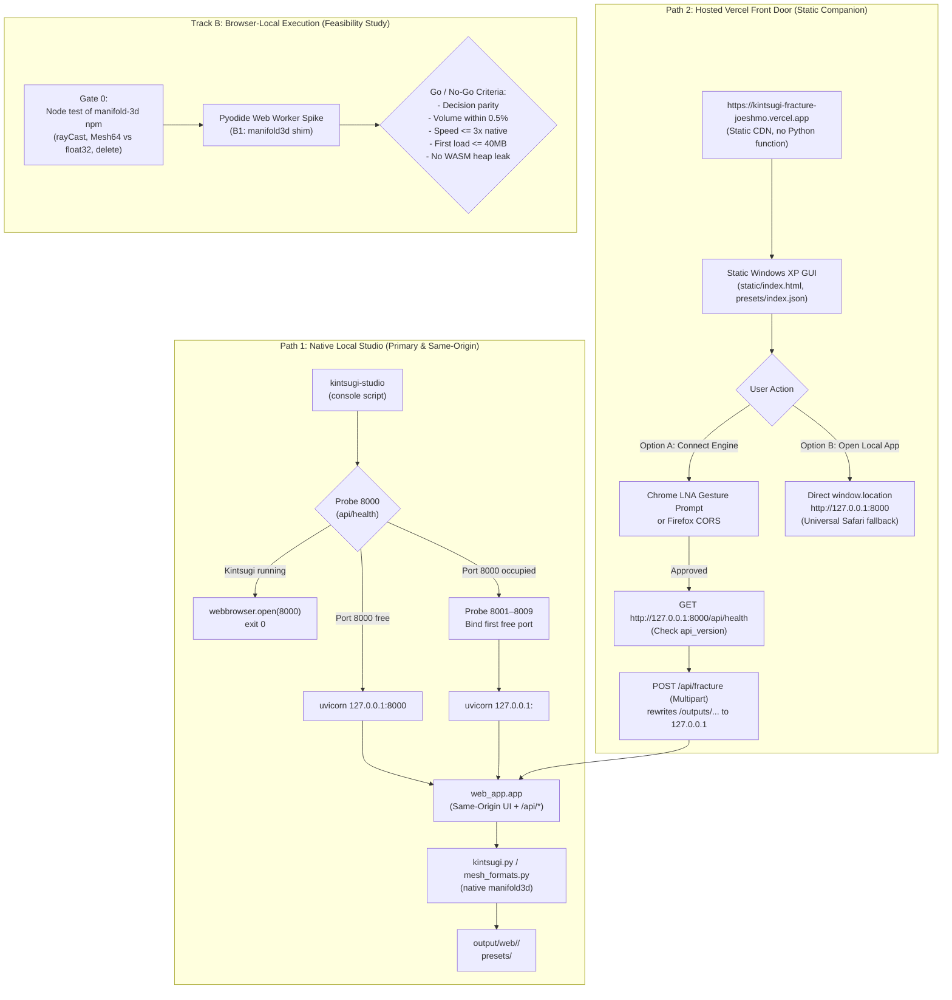

> [!NOTE]
> This document specifies **technical system architecture only** (data flow, storage, APIs, concurrency, state synchronization, and security).
> All visual, aesthetic, and UI design decisions (colors, typography, component styling, responsive layout) must be defined in `design.md`.

## Context

The app has three layers:

| Layer | Files | Size | Runtime |
| :--- | :--- | :--- | :--- |
| Viewer | `static/` (`viewer.js`, `threemf.js`, `upload.js`, three.js r160 from unpkg) | ~1.7k lines JS | Browser |
| HTTP API | `web_app.py` (FastAPI, uvicorn) | 537 lines | Python process |
| Engine | `kintsugi.py`, `mesh_formats.py`, `sample_models.py` | ~5.6k lines | Python + numpy, scipy, trimesh, manifold3d (C++ extension) |

Hosted deployment previously wrapped the API and engine in one Vercel Python function (`app.py`). Local deployment runs the same app with uvicorn on `127.0.0.1:8000`. Every hosted-only limit is listed in `research.md` (Verified facts).

## System Architecture Diagram

## Goals / Non-Goals

**Goals:**
- **Track A:** One command (`uv run kintsugi-studio` / `kintsugi-studio`) launches the complete app on loopback with zero hosted limits and universal browser compatibility (same-origin Safari, Chrome, Firefox).
- **Track A:** The hosted Vercel URL (`https://kintsugi-fracture-joeshmo.vercel.app`) serves purely static assets, eliminating Python compute costs, public upload attack surfaces, and the deferred 2 GB memory crash.
- **Track A:** Secure companion connection: server-side origin and Host header verification defending against malicious web origins (`evil.example`) and DNS rebinding.
- **Track B:** A rigorous, empirically measured feasibility study and Gate 0 criteria for browser-local execution.

**Non-Goals:**
- Packaged desktop executable (PyInstaller, Tauri) in this change.
- Altering core fracture geometry, procedural algorithms, or export mesh formats.
- Implementing Track B browser execution beyond the feasibility specification in this change.

---

## Technical Decisions

### Track A: Local-First Runtime & Companion GUI

#### A1. PEP 621 `pyproject.toml`
- **Decision:** Add `pyproject.toml` defining package metadata, dependencies matching `requirements.txt`, and entrypoint `[project.scripts] kintsugi-studio = "web_app:studio"`. Run from clone via `uv run kintsugi-studio` or `pip install -e .`.
- **Why a clone, not a wheel:** `web_app.py` resolves `static/` and `presets/` relative to `__file__`. Editable/clone installs preserve directory locality without requiring code reorganization.
- **Alternatives considered:** Reorganize into `kintsugi_studio/` package with package data. Deferred: touches all module imports across tests for personal development with no functional gain over clone-based execution.

#### A2. Launcher `studio(argv=None)` and Deterministic Port Probing (8000–8009)
- **Decision:**
  1. Parse `--host` (default `127.0.0.1`), `--port` (default 8000), `--no-open`, and `--log-level`.
  2. If `--host` is not loopback (`127.0.0.1`, `localhost`, `::1`), log a prominent warning.
  3. Probe `GET http://127.0.0.1:<port>/api/health` with a 0.5 s timeout. If `"service": "kintsugi-studio"` is returned, log that an instance is already running, open the browser to that URL (unless `--no-open`), and exit `0` without spawning a second server.
  4. If port 8000 is occupied by an unrelated service, probe sequentially across `8001` through `8009`. Bind the first free port and log the URL clearly.
  5. Poll `/api/health` in a background thread and call `webbrowser.open(url)` once ready.
- **Why range 8000–8009:** Random port 0 prevents the hosted companion GUI from discovering the port. Sequential probing allows the hosted GUI's "Connect Engine" to probe 8000–8009 within the single loopback permission granted by Chrome.

#### A3. Strict Pure ASGI Origin & Host Security Check
- **Decision:** Implement `SecurityCORSMiddleware` as pure ASGI middleware without `BaseHTTPMiddleware` (which buffers bodies).
  - **Allowed Origins**: `http://127.0.0.1:<port>`, `http://localhost:<port>`, `https://kintsugi-fracture-joeshmo.vercel.app`, and `^https://kintsugi-fracture-[a-zA-Z0-9_-]+-joeshmo\.vercel\.app$`. Configurable via `KINTSUGI_ALLOWED_ORIGINS`.
  - **Simple Request Defense**: In standard CORS, `multipart/form-data` POSTs are sent without preflight. On **every** POST, PUT, DELETE, and `/outputs/*` read, verify the `Origin` header if present. If `Origin` is present and unauthorized, immediately return HTTP 403 Forbidden before reading the request body.
  - **DNS Rebinding Defense**: Inspect the `Host` header. Reject requests where `Host` is not `127.0.0.1:<port>`, `localhost:<port>`, or `[::1]:<port>` (or the explicit `--host` argument).
  - **Preflight & LNA**: For allowed origins sending OPTIONS with `Access-Control-Request-Private-Network: true`, respond with `Access-Control-Allow-Private-Network: true`. Unauthorized origins receive 403 without CORS headers.
  - **Credentials**: `allow_credentials=False` always.

#### A4. Static Vercel Deployment & Presets Index
- **Decision:**
  - Remove `app.py` from repository (or disable it) so Vercel does not detect a FastAPI framework.
  - Update `vercel.json` with `cleanUrls: true` and rewrites to serve `static/` as root and route `/presets/:path*` to `presets/:path*`.
  - Add static file `static/presets/index.json` containing preset metadata. In `static/viewer.js`, fetch `resolveEngineUrl("/api/presets")` when connected, or fall back to `/presets/index.json` when disconnected or static.
- **Why:** Eliminates all Vercel serverless compute costs, 4.5 MB request limits, 300 s timeouts, and the 2 GB memory crash.

#### A5. Hosted Companion UI & Asset URL Rewriting
- **Decision:**
  - "Connect Engine" button (user gesture required for Chrome 142+ LNA permission prompt).
  - "Open Local App (127.0.0.1:8000) ↗" direct link as universal fallback for Safari (which blocks HTTPS $\rightarrow$ HTTP loopback as mixed content under WebKit Bug 171934).
  - `resolveEngineUrl(path)` in `viewer.js` prefixes `/outputs/...` and download URLs with the active engine base URL.
  - `api_version` handshake in `GET /api/health` (`"api_version": "1.0"`) alerts users if the local clone is out of sync.

---

### Track B: Browser-Local Execution (Feasibility Study)

#### B1. Pyodide + `manifold3d` Shim (Recommended Spike Path)
- **Concept:** Run CPython in a Web Worker via Pyodide. Implement a Python shim named `manifold3d` that wraps manifold's official WebAssembly build (`manifold-3d` npm) using Pyodide's JavaScript FFI (`pyodide.ffi`).
- **Pros:** Keeps the 4,998 lines of `kintsugi.py` unchanged in Python.
- **Cons:** FFI boundary crossings on ~11,000 ray casts per fracture; `mf.Mesh64` float64 precision truncated to float32 in WASM; mandatory explicit WASM object `.delete()`.

#### B2. Compile `manifold3d` C++ Binding for Pyodide
- **Concept:** Compile the native `manifold3d` Python C++ extension using `pyodide-build` and Emscripten.
- **Pros:** Full float64 precision and native Python binding semantics.
- **Cons:** Upstream provides no wasm wheel; requires building and maintaining a custom wheel pipeline for every Pyodide release.

#### B3. Port Engine to TypeScript
- **Concept:** Rewrite `kintsugi.py` in TypeScript against `manifold-3d`.
- **Pros:** Native JS speed, no Pyodide payload.
- **Cons:** Highest effort and risk (rewriting ~5,000 lines of complex procedural geometry and baseline tolerances).

#### Manifold API Mapping (Track B1 Shim)

| Python `manifold3d` Call | JavaScript `manifold-3d` Equivalent | Notes |
| :--- | :--- | :--- |
| `mf.Manifold(mesh)` | `Module.Manifold.ofMesh(mesh)` | Truncates float64 to float32 |
| `m.to_mesh64()` | `m.getMesh()` | Returns `Float32Array` vertices |
| `m.ray_cast(origin, end)` | `m.rayCast(origin, end)` | ~11,000 crossings per run |
| `m1 - m2`, `m1 ^ m2`, `m1 + m2` | `m1.subtract(m2)`, `m1.intersect(m2)`, `m1.add(m2)` | Must `.delete()` inputs |
| `mf.Manifold.batch_boolean(...)` | `Module.Manifold.union(manifolds)` | Array of WASM pointers |
| `m.volume()` | `m.volume()` | Scalar float |
| `m.decompose()` | `m.decompose()` | Returns array of Manifold |
| `m.is_empty()` | `m.isEmpty()` | Boolean |
| `mf.CrossSection.revolve(...)` | `Module.Manifold.revolve(cross, ...)` | Revolve geometry |
| Manual cleanup | `m.delete()` | Mandatory to prevent leaks |

---

## Risks / Trade-offs

### Track A (Local-First Companion)

| Risk | Likelihood | Impact | Mitigation |
| :--- | :--- | :--- | :--- |
| Cross-origin simple POST attack from malicious web origins | High (if unmitigated) | High: Disk fill or memory exhaustion | Server-side `Origin` check on all POSTs and `/outputs/*` returning 403; Host header verification against DNS rebinding |
| Safari blocks HTTPS $\rightarrow$ HTTP loopback | Certain | Medium: Hosted companion cannot connect in Safari | Display clear diagnostic banner with direct link: `Open Local App (127.0.0.1:8000) ↗` |
| Chrome LNA permission prompt dismissed or blocked | Medium | Medium: Companion cannot connect | Explicit "Connect Engine" user gesture; clear status guidance |
| Vercel deploys Python backend despite removing `functions` | High (if `app.py` remains) | Medium: Unwanted serverless billing and open public endpoint | Remove `app.py`, configure static framework and rewrites |
| Engine port collision on 8000 | Medium | Low | Sequential probe 8000–8009; instance reuse via `/api/health`; GUI manual port input |

### Track B (Browser-Local Feasibility)

| Risk | Likelihood | Impact | Mitigation |
| :--- | :--- | :--- | :--- |
| ~11,000 ray casts cause severe FFI latency in Pyodide | High | High: Fracture takes >30 s in browser | Measure in Gate 0 / spike; batch ray queries or move ray probe loop to JS helper |
| `Mesh64` float64 truncation to float32 causes boolean self-intersections | Medium-high | High: Meshes fail manifold watertight checks | Verify in Gate 0 on `tea_bowl` and `bowl_urdformer` before building shim |
| Memory leak in WASM heap from undeleted Manifold instances | High | High: Tab crashes after multiple fractures | Implement strict arena or scope-based `.delete()` in shim; verify heap across 20 runs |
| First-load payload exceeds acceptable limits | High | Medium: Slow first visit | Measure Pyodide + scientific wheels; cache with Service Worker |

### Effort Estimates

| Item | Estimate |
| :--- | :--- |
| Track A (Local launcher, static Vercel, ASGI security, companion UI) | 1–2 days |
| Track B Gate 0 (Node script testing published `manifold-3d` npm) | 0.5 days |
| Track B Spike (Pyodide Worker + minimal shim) | 1–2 days |
| Track B1 Full Implementation (Complete shim, tests, CI) | 2–3 weeks |
| Track B2 Custom Wheel Pipeline | 2–4 weeks (high variance) |
| Track B3 TypeScript Port | 6+ weeks |

---

## Track B Spike: Gate 0 & Go/No-Go Criteria

### Gate 0 (Mandatory Precursor)
Execute a standalone Node script with published `manifold-3d`:
1. Import real vessel mesh (`tea_bowl.stl`).
2. Execute 1,000 `rayCast` calls and measure crossing overhead.
3. Perform one boolean cut with cutter manifold.
4. Export STL and verify watertightness.
5. Verify explicit `.delete()` frees memory without heap growth.

### Go/No-Go Criteria (Spike Evaluation)
1. **Decision Parity**: Same accept/reject envelope decisions as native on `tea_bowl` and `bowl_urdformer`.
2. **Geometric Parity**: Fragment count matches; volumes within 0.5% of native reference.
3. **Speed**: Total fracture time $\le 3\times$ native on desktop browser ($\le 8.3\text{ s}$ on `tea_bowl` hybrid).
4. **Payload**: First load $\le 40\text{ MB}$; cached load $\le 3\text{ s}$.
5. **Memory Stability**: Zero WASM heap growth ($< 10\%$) over 20 consecutive fractures.

---

## Migration & Rollback Plan

- **Track A Rollback**:
  - If static Vercel deployment encounters issues, restoring `app.py` and adding `"functions": { "app.py": { "maxDuration": 300 } }` to `vercel.json` immediately restores the serverless Python deployment.
  - The local launcher is fully backward compatible: `python web_app.py` remains identical and functional.
- **Track B Rollback**:
  - Track B involves no production code modifications; spike artifacts remain isolated in scratch areas.
