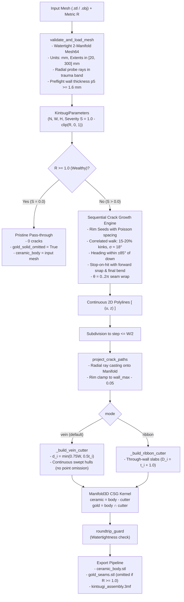

> [!NOTE]
> This document specifies **technical system architecture only** (data flow, storage, APIs, concurrency, state synchronization, and security).
> All visual, aesthetic, and UI design decisions (colors, typography, component styling, responsive layout) must be defined in `design.md`.

## Context

The Kintsugi fracture engine fractures 3D vessel meshes driven by economic inequality $R$. In earlier iterations, the engine attempted to support sub-millimeter vase-mode vessels ($t < 1.0\text{ mm}$). Chasing a $0.8\text{ mm}$ ceramic backing on a $0.8\text{ mm}$ wall forced vein depth formula $d = t - 0.8\text{ mm}$, leading to $d \to 0$. This introduced tangent cutter contact ("kissing bug"), requiring an artificial $0.25\text{ mm}$ cutoff that omitted all cutter points on thin models like `thin_cylinder`, creating empty 84-byte gold STL files and misleading UI states.

Real ceramic pottery and multi-material 3D prints require multi-perimeter shells ($t \ge 1.6\text{ mm}$). Single-perimeter spiral vase mode cannot physically support multi-material inlays on FDM slicers. Restricting the engine's supported envelope to $p_5 \ge 1.6\text{ mm}$ mathematically guarantees nominal ceramic backing $\ge 0.8\text{ mm}$ under $d = \min(0.75W, 0.5t)$ everywhere, eliminating the entire point-omission and tangency cascade while providing bold, unbroken gold seams.

## System Architecture Diagram

## Goals / Non-Goals

**Goals:**
- **Ceramic Envelope Enforcement ($p_5 \ge 1.6\text{ mm}$)**: Preflight validation of wall thickness across the trauma band, rejecting sub-millimeter shells with an informative `ValueError` before any fracture operations begin.
- **Continuous, Deep Gold Veins**: Restore $d_i = \min(0.75W, 0.5t_i)$, eliminating cutter point omission (`d < 0.25 mm`), polyline splitting (`_vein_point_groups`), and partial groove fading.
- **Guaranteed Solid Backing ($\ge 0.8\text{ mm}$)**: Because $d_i \le 0.5t_i$ and $t_i \ge 1.6\text{ mm}$, remaining ceramic backing $t_i - d_i \ge 0.5t_i \ge 0.8\text{ mm}$ is mathematically guaranteed everywhere.
- **Eliminate Stopping-Short Gaps**: On final collision attempt, near-misses within clearance $R_{\text{clear}}$ at $\ge 30^\circ$ bend onto the nearest point of the hit segment, establishing a shared T-junction vertex.
- **Natural Organic Fracture Morphology**: Reduce kink rate from 50% to 15–20% and use Gaussian $\sigma \approx 18^\circ$ heading drift to avoid artificial staircase lightning while preserving median tortuosity $\ge 1.05$.
- **Robust Defensive Safeguards**: Retain `_gold_solid_omitted` in exporter and `seams_omitted` in API for pristine/wealthy runs ($R \ge 1.0$).

**Non-Goals:**
- Supporting single-perimeter spiral vase mode prints (physically incompatible with dual-material inlays).
- Dynamically inflating or thickening sub-1.6 mm meshes during ingestion.
- Exposing legacy Voronoi generator in user-facing GUI.
- Adding third-party graph dependencies (`networkx`).

## Technical Decisions

### Decision 1: Preflight Two-Hit Wall Thickness Sampling ($p_5 \ge 1.6\text{ mm}$)
- **Chosen**: In `validate_and_load_mesh`, reuse the preflight radial ray grid across the trauma band. Cast inward rays from the exterior hits into the mesh to measure local wall thickness $t$. If the 5th percentile $p_5 < 1.6\text{ mm}$, raise `ValueError(f"Input vessel wall thickness (5th percentile: {p5:.2f} mm) is below the minimum ceramic envelope requirement of 1.60 mm.")`.
- **Rationale**: Rejects unprintable thin-shell models early and cleanly, preventing degraded cuts or geometry failures downstream.

### Decision 2: Classical Continuous Vein Depth Formula
- **Chosen**: Set $d_i = \min(0.75W, 0.5t_i)$ along all cutter points. Remove `GROWTH_MIN_DEPTH_MM`, `_vein_point_groups`, and path splitting logic.
- **Rationale**: For all meshes meeting the $p_5 \ge 1.6\text{ mm}$ requirement, $d_i \le 0.5 \times 1.6\text{ mm} = 0.8\text{ mm}$, leaving at least $0.8\text{ mm}$ ceramic backing. Minimum depth on any valid cut with $W \ge 2.2\text{ mm}$ is $\min(1.65, 0.8) = 0.8\text{ mm} \gg 0.25\text{ mm}$, so cutter spheres are always deeply embedded without tangency or kissing-edge risk.

### Decision 3: Crack Growth Final-Attempt Snapping & Morphology
- **Chosen**:
  - Advancing segments within clearance $R_{\text{clear}} = W + 0.8\text{ mm}$ project forward to the earliest hit segment and split it with a shared vertex.
  - If forward projection fails, on the final attempt the step bends directly onto the nearest point on the hit segment if arrival angle $\ge 30^\circ$ and the bent segment is collision-free.
  - Sharp kink probability is set to 15–20%, with remaining steps sampled from Gaussian $\sigma \approx 18^\circ$.
- **Rationale**: Eliminates parallel dead-end gaps where cracks stopped 2–3 mm short, and removes the artificial zig-zag "staircase" look while ensuring planar graphs (0 crossings).

### Decision 4: Exporter Defensive Safeguards
- **Chosen**: Keep `_gold_solid_omitted` logic in `kintsugi.py` and `seams_omitted` in `web_app.py`. For $R \ge 1.0$, `gold_solid_omitted` is True and no empty STL is written. For $R < 1.0$ on valid ceramic meshes, `gold_solid_omitted` is False and complete gold STL/3MF components are written.
- **Rationale**: Cleanly handles intentional zero-crack wealthy runs without generating corrupt 84-byte files.

## Risks / Trade-offs

- **[Risk] Existing thin-cylinder test fixtures fail preflight validation** → *Mitigation*: Move `thin_cylinder` (0.7–1.2 mm) into negative test cases verifying that `validate_and_load_mesh` raises `ValueError`, and add a dedicated boundary test model with $p_5 = 1.6\text{ mm}$.
- **[Risk] User uploads a thin vase STL** → *Mitigation*: The web API `/api/validate` catches `ValueError` and surfaces `Not a valid closed solid: Input vessel wall thickness (X.XX mm) is below ceramic envelope requirement of 1.60 mm` in the UI status bar.

## Migration & Rollback Plan

- **Deployment**: Single commit updating `kintsugi.py`, `sample_models.py`, `web_app.py`, and test fixtures.
- **Rollback**: Git revert restores prior commit if unexpected regressions occur.
