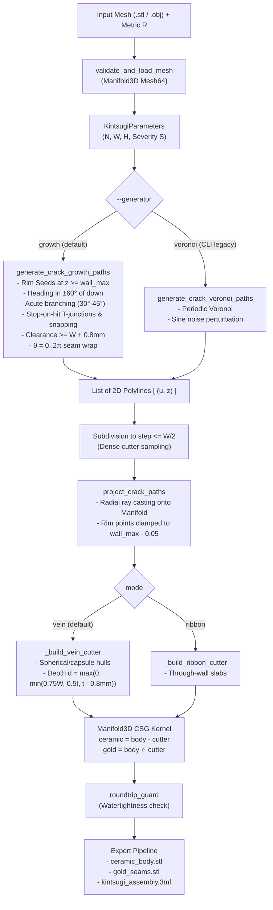

> [!NOTE]
> This document specifies **technical system architecture only** (data flow, storage, APIs, concurrency, state synchronization, and security).
> All visual, aesthetic, and UI design decisions (colors, typography, component styling, responsive layout) must be defined in `design.md`.

## Context

The system (`kintsugi-fracture`) fractures 3D vessel meshes driven by economic disparity $R$. The CSG boolean engine (`manifold3d`), swept convex-hull cutters (`_build_vein_cutter`, `_build_ribbon_cutter`), binary STL exporter, and 3MF container generator are mature and verified through rigorous 160-seed sweeps. The crack generator, however, previously used SciPy Voronoi diagrams perturbed by sine noise, which produced polygonal bathroom-tile geometry and suffered from noise-folding crossings (F18).

This architecture replaces the crack generator with a **Sequential Rim-Seeded Crack Growth Engine with Stop-on-Hit**, preserving the exact polyline interface consumed by the downstream pipeline.

## System Architecture Diagram

## Goals / Non-Goals

**Goals:**
- **Zero Crossings by Construction**: Eliminating F18 entirely without relying on global 2D displacement fields or Lipschitz bounds.
- **Organic Lightning Morphology**: Natural dendritic tree branching, acute angles ($30^\circ\text{–}45^\circ$), and authentic T-junctions.
- **Shared Vertex Subdivision**: When a crack stops at an existing segment, the hit segment is subdivided so the junction vertex is explicitly shared by both polylines.
- **Seam Continuity & Clearance**: Seamless traversal across the unrolled cylindrical meridian ($\theta = 0 \leftrightarrow 2\pi$) while keeping non-intersecting parallel cracks at least $W + 0.8\text{ mm}$ apart.
- **Thin-Wall Protection**: Guaranteed $\ge 0.8\text{ mm}$ ceramic wall backing in vein inlay mode; grooves fade to zero depth where wall thickness $\le 0.8\text{ mm}$.
- **Drop-in Compatibility**: 100% preservation of downstream CSG, export formats, and REST API.

**Non-Goals:**
- Exposing Voronoi controls in the Web GUI (Voronoi is strictly an internal CLI/test flag `--generator voronoi`).
- Supporting arbitrary non-cylindrical geometries (e.g. multi-branching tree shapes or non-star-shaped vessels).
- Modifying the underlying C++ `manifold3d` CSG kernel or export schemas.
- Adding third-party graph dependencies (such as `networkx`).

## Technical Decisions

### Decision 1: Rim-Seeded Growth with Stop-on-Hit & Vertex Snapping
- **Chosen**: Step-by-step segment propagation from rim seeds down through the trauma band. When an advancing segment intersects or comes within clearance distance $W$ of an existing segment, the advancing end snaps to the closest point $\mathbf{p}_{\text{hit}}$, terminates growth, and subdivides the hit segment at $\mathbf{p}_{\text{hit}}$.
- **Rationale**: Physical brittle fractures in ceramics originate at stress concentrations (the rim/lip) and propagate downwards. Stop-on-hit with explicit vertex insertion naturally generates shared T-junctions without crossings, replacing ~400 lines of Voronoi ray clipping, boundary clamping, and noise folding with straightforward, robust 2D computational geometry.

### Decision 2: Spatial Collision Detection with Periodic Wrapping & Clearance
- **Chosen**: A 2D segment intersection and distance check in $(u, z)$ space where every candidate segment $\mathbf{s} = (\mathbf{p}_1, \mathbf{p}_2)$ is tested against all committed segments, as well as their periodic twins shifted by $\pm 2\pi\bar{r}$, and the crack's own earlier non-adjacent segments.
- **Rationale**: Total crack segment count $M$ during growth is small ($M \le 200$), so exact segment-to-segment distance checks take $< 1\text{ ms}$ in pure NumPy while preventing parallel channels from merging into unprintable blobs.

### Decision 3: Separation of Growth Step Length from Cutter Sampling
- **Chosen**: Growth steps advance by $[1.5W, 3.0W]$ to create macro-level directional jaggedness. Before feeding into `_build_vein_cutter`, polylines are subdivided to fine step length $\le W/2$.
- **Rationale**: Decouples the morphological random-walk frequency from cutter sampling, preventing spherical cutter bloat and maintaining smooth CSG boolean operations.

### Decision 4: Non-Puncturing Vein Inlay Depth Formula
- **Chosen**: $d_i = \max(0.0,\ \min(0.75\,W,\ 0.5\,t_i,\ t_i - 0.8\text{ mm}))$.
- **Rationale**: On thin pottery ($t_i \le 1.0\text{ mm}$), carving a fixed depth would puncture the ceramic or leave sub-nozzle skins. Clamping with a floor of $0.0$ allows the channel to fade out safely rather than leaking.

## Risks / Trade-offs

- **[Risk] Acute Branch Spikes**: Branches departing at very sharp angles ($< 25^\circ$) leave razor-thin ceramic wedges that challenge 3D printer nozzles.
  - **Mitigation**: Constrain child branch departure angles to $[30^\circ, 45^\circ]$ and enforce minimum T-junction arrival incidence angle $\ge 30^\circ$.
- **[Risk] Determinism and Growth Order**: In a stop-on-hit system, the winner of a collision depends on growth order.
  - **Mitigation**: Advance cracks via a deterministic FIFO queue in spawn order, one step per turn, using seeded pseudo-random number generators.
- **[Risk] Downstream Test Suite Regressions**: Tests specifically written for Voronoi topology (`test_crack_paths_lie_on_periodic_voronoi`) will fail if growth is enabled globally without a flag.
  - **Mitigation**: Expose `--generator growth|voronoi`. Keep legacy Voronoi generator intact under `generate_crack_voronoi_paths` so existing Voronoi regression tests pass, while new tests validate growth topology.
