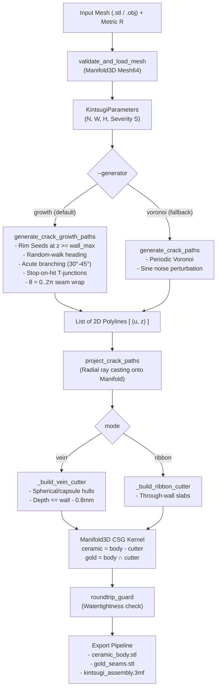

> [!NOTE]
> This document specifies **technical system architecture only** (data flow, storage, APIs, concurrency, state synchronization, and security).
> All visual, aesthetic, and UI design decisions (colors, typography, component styling, responsive layout) must be defined in `design.md`.

## Context

The system (`kintsugi-fracture`) fractures 3D vessel meshes driven by economic disparity $R$. The CSG boolean engine (`manifold3d`), swept convex-hull cutters (`_build_vein_cutter`, `_build_ribbon_cutter`), binary STL exporter, and 3MF container generator are mature and verified through rigorous 160-seed sweeps. The crack generator, however, previously used SciPy Voronoi diagrams perturbed by sine noise, which produced polygonal bathroom-tile geometry and suffered from noise-folding crossings (F18).

This architecture replaces the crack generator with a **Sequential Rim-Seeded Crack Growth Engine with Stop-on-Hit**, preserving the exact polyline interface consumed by the downstream pipeline.

## System Architecture Diagram

## Goals / Non-Goals

**Goals:**
- **Zero Crossings by Construction**: Eliminating F18 entirely without relying on global 2D displacement fields or Lipschitz bounds.
- **Organic Lightning Morphology**: Natural dendritic tree branching, acute angles ($30^\circ\text{–}45^\circ$), and authentic T-junctions.
- **Seam Continuity**: Seamless traversal across the unrolled cylindrical meridian ($\theta = 0 \leftrightarrow 2\pi$).
- **Thin-Wall Protection**: Guaranteed $\ge 0.8\text{ mm}$ ceramic wall backing in vein inlay mode.
- **Drop-in Compatibility**: 100% preservation of downstream CSG, export formats, CLI, and REST API.

**Non-Goals:**
- Supporting arbitrary non-cylindrical geometries (e.g. multi-branching tree shapes or non-star-shaped vessels).
- Modifying the underlying C++ `manifold3d` CSG kernel or export schemas.
- Adding third-party graph dependencies (such as `networkx`).

## Technical Decisions

### Decision 1: Rim-Seeded Growth with Stop-on-Hit vs Voronoi
- **Chosen**: Step-by-step segment propagation from rim seeds down through the trauma band. When an advancing segment intersects an existing segment within distance $W$, it truncates at the intersection point and forms a T-junction.
- **Rationale**: Physical brittle fractures in ceramics originate at stress concentrations (the rim/lip) and propagate downwards. Stop-on-hit naturally generates T-junctions without crossings, replacing ~400 lines of Voronoi ray clipping, boundary clamping, and noise folding with ~150 lines of straightforward 2D computational geometry.
- **Alternative Considered**: Midpoint displacement alone. Rejected because displaced curves can collide with neighboring branches unless bounded by an expensive collision solver.

### Decision 2: Spatial Collision Detection with Periodic Wrapping
- **Chosen**: A 2D segment intersection check in $(u, z)$ space where every candidate segment $\mathbf{s} = (\mathbf{p}_1, \mathbf{p}_2)$ is tested against all committed segments, as well as their periodic twins shifted by $\pm 2\pi\bar{r}$.
- **Rationale**: Since total crack segment count $M$ is typically small ($M \le 300$ across all branches), direct segment intersection is sub-millisecond in pure NumPy, avoiding heavy spatial tree data structures while guaranteeing seam continuity across $\theta = 0$.

### Decision 3: Vein Cutter Wall-Thickness Clearance
- **Chosen**: In `kintsugi.py`, clamping vein inlay cutter depth to $d_i = \min(0.75\,W,\ 0.5\,t_i,\ \max(0.2,\ t_i - 0.8\text{ mm}))$.
- **Rationale**: In thin-wall pottery (e.g. 1.2–1.8 mm walls), carving a 1.0 mm deep channel leaves as little as 0.2 mm of ceramic, causing slicer gaps or physical leaks. Enforcing an explicit 0.8 mm backing floor prevents punctures while keeping the gold channel distinct.

## Risks / Trade-offs

- **[Risk] Acute Branch Spikes**: Branches departing at very sharp angles ($< 25^\circ$) leave razor-thin ceramic wedges that challenge 3D printer nozzles.
  - **Mitigation**: Constrain child branch angle departure to $[30^\circ, 45^\circ]$ and enforce minimum segment step length $\ge W/2$.
- **[Risk] Overlapping Sphere Cutters at T-Junctions**: At T-junctions, the terminal cutter sphere coincides with an existing cutter line, creating a localized volume overlap.
  - **Mitigation**: Handled natively and cleanly by `manifold3d`'s volumetric union: $(A \cup B)$ merges overlapping convex hulls seamlessly into a single manifold solid before subtracting from the body.
- **[Risk] Downstream Test Suite Regressions**: Tests specifically written for Voronoi topology (`test_crack_paths_lie_on_periodic_voronoi`) will fail if growth is enabled globally.
  - **Mitigation**: Expose `--generator growth|voronoi`. Keep legacy Voronoi generator intact under `generate_crack_voronoi_paths` so existing Voronoi regression tests pass, while new tests validate growth topology.

## Migration & Rollback Plan

1. **Step 1**: Implement `tools/spike_growth.py` to visually and geometrically validate growth polylines on preset vessels.
2. **Step 2**: Add `generate_crack_growth_paths` to `kintsugi.py` behind `--generator growth|voronoi`, setting `growth` as default.
3. **Step 3**: Update FastAPI `/api/fracture` payload schema with optional `generator: str = "growth"`.
4. **Step 4**: Update Web GUI controls to default to `vein` and expose the generator toggle.
5. **Rollback**: If unexpected CSG edge cases arise, the generator can be reverted instantly to `voronoi` via CLI flag `--generator voronoi` or API parameter.
