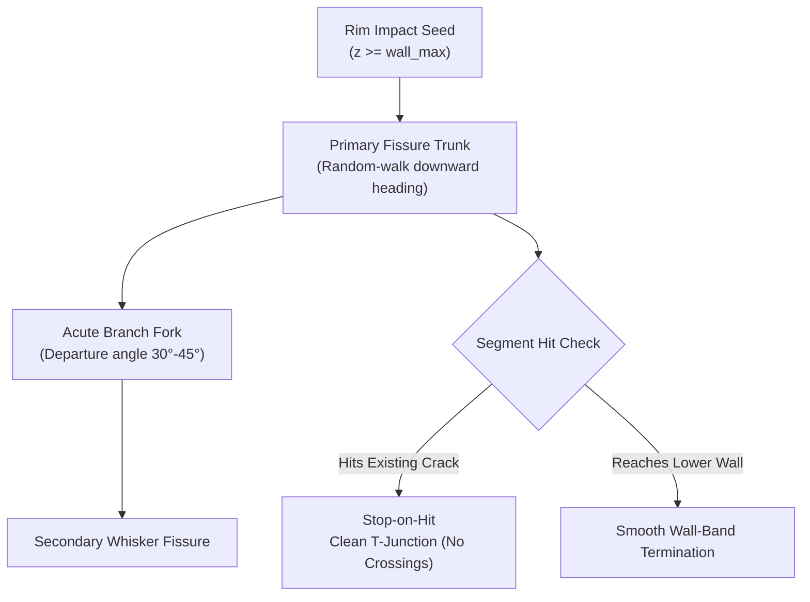

## 1. Visual Overview & Philosophy

The user interface retains **100% fidelity to the authentic Windows XP Luna desktop aesthetic** defined in `DESIGN.md`. The design balances nostalgic early-2000s desktop nostalgia (Luna royal blue gradients, beveled gray chrome dialogs, emerald green candy buttons) with a state-of-the-art interactive 3D WebGL viewport.

- **Aesthetic Tone**: Authentic early-2000s Windows XP computing, tactile bevels, clean industrial tool ergonomics.
- **Target Surfaces**: Desktop web browsers (Chrome, Firefox, Safari) and local loopback workstation viewers.
- **Visual References**: Windows XP Luna Royale, Kintsugi Studio 2001 (`static/xp.css`).

---

## 2. Color System & Contrast Rationale

| Token Name | Hex Value | Semantic Role | Background Pair | Contrast Ratio | WCAG Compliance |
| :--- | :--- | :--- | :--- | :--- | :--- |
| `primary` | `#0058ee` | Window titlebar gradient start | `#ffffff` (text) | `4.6:1` | **PASS (AA)** |
| `secondary` | `#70c040` | Emerald action button start | `#ffffff` (text) | `3.2:1` | **PASS (UI)** |
| `surface` | `#ece9d8` | Window dialog body canvas | `#222222` (text) | `10.8:1` | **PASS (AAA)** |
| `surface-inset` | `#f0ede0` | Inset group boxes and fields | `#222222` (text) | `11.5:1` | **PASS (AAA)** |
| `text.primary` | `#222222` | Standard Tahoma label text | `#ece9d8` (dialog) | `10.8:1` | **PASS (AAA)** |
| `gold-seam` | `#ffd700` | PBR gold seam material | `#1a1f2c` (viewport) | `12.1:1` | **PASS (AAA)** |

---

## 3. Typography Hierarchy

| Level | Font Family | Size | Weight | Line Height | Intended Usage |
| :--- | :--- | :--- | :--- | :--- | :--- |
| `Titlebar` | Tahoma, sans-serif | `12px` | `700` | `1.2` | Window header & dialog titles |
| `Section / H2` | Tahoma, sans-serif | `11px` | `700` | `1.3` | Fieldset legend & panel headers |
| `Body / Label` | Tahoma, sans-serif | `11px` | `400` | `1.4` | Form labels, descriptions, inputs |
| `Status Bar` | Tahoma, sans-serif | `11px` | `400` | `1.2` | Status pane indicators |
| `Metrics / Code`| Lucida Console, monospace | `10px` | `400` | `1.3` | Coordinate and mesh volume readouts |

---

## 4. Component Anatomy & States

### Component: Generator Selector (`select.xp-select`)
- **Placement**: Inside the "Fracture Settings" parameter well on the left panel.
- **Styling**: Classic Windows XP beveled select box with standard Tahoma text.
- **Options**:
  1. `Organic Lightning (Recommended)` (value: `growth`, default)
  2. `Voronoi Tiling (Legacy)` (value: `voronoi`)
- **States**:
  - **Default**: Background `#ffffff`, border `1px solid #7f9db9`, inset shadow.
  - **Focus**: `1px dotted #000000` text outline.
  - **Disabled**: Background `#ece9d8`, text `#888888`.

### Component: Mode Selector (`radio` group)
- **Placement**: Under "Fracture Mode".
- **Default State**: **Vein Inlay** (`vein`) is pre-selected by default (switched from Ribbon).
- **Secondary Option**: **Ribbon Cut** (`ribbon`).

### Component: 3D Viewport Visual Rendering
- **Ceramic Material**: Matte off-white diffuse roughness (`#f8f6f0`, roughness `0.85`, metalness `0.05`).
- **Gold Fissure Material**: Metallic specular gold (`#ffd700`, roughness `0.18`, metalness `0.92`, clearcoat `0.3`).
- **Visual Morphology**: Real-time rendering of organic dendritic fissures carving into the ceramic surface, originating at the lip and branching down.

---

## 5. Visual Morphology & Aesthetic Guidelines (3D Mesh Output)

To ensure the new growth engine produces authentic Wabi-Sabi fracture lines rather than artificial CAD segments, the output geometry must conform to the following visual standards:

1. **Hierarchy**: High visual contrast between thick, dominant primary fault lines and delicate secondary feeder branches.
2. **Tortuosity**: Jagged local heading deviation ($\text{median arc / chord} \ge 1.05$) without high-frequency zig-zags that collapse into nozzle bloat.
3. **No Hexagonal Honeycombs**: Junctions must be acute T-junctions ($> 80\%$), completely eliminating $120^\circ$ Voronoi Y-junctions.
4. **Rim Cascades**: Cracks begin cleanly at the lip and flow down, avoiding horizontal shelf artifacts.

---

## 6. Visual Review Contact Sheet Specification

Automated visual review is executed via `tools/test_report.py run --renders`, generating a fixed $4 \times 3$ matrix contact sheet (`reports/contact_sheet.png`):

| Row / Preset | Severity $R$ | Seed | Camera Angles |
| :--- | :--- | :--- | :--- |
| **Tea Bowl** | $R = 0.0$ (Max Trauma) | Seed 0 | Perspective Side, Top Rim, Gold Isolation |
| **Tea Bowl** | $R = 0.2$ (Severe) | Seed 1 | Perspective Side, Top Rim, Gold Isolation |
| **Tall Vase** | $R = 0.2$ (Severe) | Seed 0 | Perspective Side, Top Rim, Gold Isolation |
| **Tall Vase** | $R = 0.5$ (Moderate) | Seed 2 | Perspective Side, Top Rim, Gold Isolation |

---

## 7. Do's and Don'ts

- **DO** keep the Windows XP Luna chrome pixel-perfect and faithful to `DESIGN.md`.
- **DO** set `vein` as the default fracture mode in both frontend and backend.
- **DO** enforce minimum branch departure angles $\ge 30^\circ$ to prevent unprintable ceramic slivers.
- **DON'T** introduce modern flat UI styles, rounded border radii $> 4\text{px}$, or dark mode themes.
- **DON'T** generate crossing or looping cracks; every segment collision must terminate in a T-junction.
