> [!NOTE]
> This document specifies **technical system architecture only** (data flow, storage, APIs, concurrency, state synchronization, and security).
> All visual, aesthetic, and UI design decisions (colors, typography, component styling, responsive layout) must be defined in `design.md`.

## Context

The app has three layers:

| Layer | Files | Size | Runtime |
| :--- | :--- | :--- | :--- |
| Viewer | `static/` (`viewer.js`, `threemf.js`, `upload.js`, three.js r160 from unpkg) | ~1.7k lines JS | Browser |
| HTTP API | `web_app.py` (FastAPI, uvicorn) | 537 lines | Python process |
| Engine | `kintsugi.py`, `mesh_formats.py`, `sample_models.py` | ~5.6k lines | Python + numpy, scipy, trimesh, manifold3d (C++ extension) |

Hosted deployment wraps the API and engine in one Vercel Python function (`app.py`). Local deployment runs the same app with uvicorn on `127.0.0.1:8000`. Every hosted-only limit is listed in research.md (Verified facts).

## System Architecture Diagram

```mermaid
flowchart TB
    subgraph A["Track A: native local (proposed)"]
        CLI["kintsugi-studio\n(console script)"] --> Port{"port 8000 free?"}
        Port -- yes --> U["uvicorn 127.0.0.1:8000"]
        Port -- no --> U2["uvicorn 127.0.0.1:<free port>"]
        U --> App["web_app.app\n(UI + /api/*)"]
        U2 --> App
        CLI --> Open["webbrowser.open(url)"]
        App --> Eng["kintsugi.py / mesh_formats.py\n(native manifold3d)"]
        Eng --> Disk["output/web/<job>/\npresets/local/"]
    end
    subgraph H["Hosted (demo-only)"]
        V["Vercel function\nKINTSUGI_DEMO_MODE=1"] --> P["presets only;\n/api/validate and uploads -> 403 envelope"]
    end
    subgraph B["Track B1: browser-local (spike only)"]
        Page["static page\n(cached)"] --> W["Web Worker"]
        W --> Py["Pyodide\nnumpy, scipy, trimesh (micropip)"]
        Py --> Shim["manifold3d shim (Python)"]
        Shim -- "pyodide.ffi" --> MW["manifold WASM\n(manifold-3d npm)"]
        Py --> MemFS["Emscripten in-memory FS\n(input.stl, outputs)"]
        MemFS --> Blob["Blob URLs\n(downloads)"]
    end
```

## Goals / Non-Goals

**Goals:**
- **Track A:** one command from a clone gives the full app locally, with no hosted limits and no engine changes.
- **Track A:** the public Vercel URL stops accepting arbitrary uploads (demo-only), or is removed.
- **Track B:** a clear, measured go/no-go on running the engine entirely in the browser, with the effort and risks known before any build work.

**Non-Goals:**
- A packaged desktop app or installer (PyInstaller, Tauri). It can follow later.
- A hosted page talking to a local server (research.md, Raised but not acted on).
- Changing engine behaviour, generators, validation or export.
- Building Track B beyond the spike in this change.

## Technical Decisions

### Track A: native local

#### A1. `pyproject.toml`, run from a clone
- **Decision:**
  - Add a PEP 621 `pyproject.toml`: name `kintsugi-studio`, `requires-python = ">=3.10"`, and dependencies copied from `requirements.txt` (kept for Vercel, which reads it).
  - Add `[project.scripts] kintsugi-studio = "web_app:studio"`.
  - Use setuptools with `py-modules = ["kintsugi", "mesh_formats", "sample_models", "web_app"]`. Install editable (`pip install -e .`) or run directly (`uv run kintsugi-studio`).
- **Why a clone, not a wheel:** `web_app.py` finds `static/` and `presets/` relative to `__file__`. A flat-module wheel installs the modules into `site-packages` without those folders. The editable install keeps `__file__` in the clone, so nothing moves.
- **Alternative considered:** restructure into a `kintsugi_studio/` package with `static/` and `presets/` as package data, so `pipx install` works from PyPI or git. Deferred: it renames every import in about 8 test modules, `app.py` and the tools, for a benefit (installing without a clone) that personal use doesn't need.

#### A2. Launcher `web_app.studio()`
- **Decision:** a new entry point next to the existing `main()`:
  1. Parse `--host` (default `127.0.0.1`), `--port` (default 8000), `--no-open` and `--log-level`.
  2. If the port is taken, bind a socket to port 0 to get a free port. Never bind `0.0.0.0` unless `--host` is passed explicitly.
  3. Open the browser with `webbrowser.open` once the server answers `/api/health`: a background thread polls with a 10 s timeout. Skip it with `--no-open` or when no display is available (`webbrowser` returns `False`).
  4. Print the URL and the output folder, then run uvicorn in the foreground. Ctrl-C stops it.
- **Why not `uvicorn web_app:app` in the docs:** the free-port fallback, the browser open and the local-profile defaults belong in one place that tests can call.

#### A3. Local profile
- **Decision:** no new settings. The non-Vercel defaults already form the local profile:
  - `MAX_UPLOAD_BYTES` 50 MiB;
  - `OUTPUT_DIR = output/web`;
  - job TTL 3600 s, 50 jobs.

  The launcher prints them. The `presets/local/` drop folder comes from the `local-preset-drop-folder` change (currently on `docs/kintsugi-shard-seams`) and is not re-specified here.

#### A4. Hosted demo-only mode
- **Decision:** `KINTSUGI_DEMO_MODE` (truthy) makes:
  - `POST /api/validate` return 403 with the app error envelope: `detail: "Uploads are disabled on the hosted demo; run kintsugi-studio locally"`, `error_type: "DemoMode"`;
  - `POST /api/fracture` reject a `file` field the same way, while presets keep working;
  - `GET /api/health` report `demo_mode: true` and `max_upload_bytes: 0`;
  - the viewer disable the upload zone, using the existing pre-flight from PR #11: a zero limit refuses every file, with demo-specific copy.
- **Why a flag rather than deleting the deployment:** it keeps a shareable link for presets, and removes the public upload surface, including the PR #11 memory follow-up. It's off by default, so local runs are unaffected.
- **Alternative:** delete the Vercel project (owner's call), then drop `app.py`, `vercel.json` and `.vercelignore`.

#### A5. Docs and tests
- **README quickstart:** `git clone`, then `uv run kintsugi-studio` or `python -m venv .venv && pip install -e . && kintsugi-studio`.
- **Tests:**
  - the launcher's port fallback, with a socket already bound;
  - `--no-open` doesn't call `webbrowser`;
  - in demo mode, the 403 envelopes, `health.demo_mode`, and presets still fracturing;
  - with demo mode off, nothing changes. All existing tests must pass unchanged.

### Track B: browser-local (feasibility)

#### B0. What has to change, whichever route
| Piece | Today | Browser-local |
| :--- | :--- | :--- |
| HTTP API | FastAPI routes | Replaced by Worker messages: `{op: "validate"|"fracture", bytes, params}` → `{result, files}` |
| File storage | `output/web/<job>/` on disk | Emscripten in-memory FS inside Pyodide, then `Blob` URLs for download |
| Presets | `sample_models.ensure_presets` writes STLs | Same Python code, written to the in-memory FS on first use |
| Engine | Native CPython | Pyodide CPython (WebAssembly) |
| numpy / scipy | Native wheels | Pyodide builds (numpy 2.4.6, scipy 1.18.0 available) |
| trimesh | Native wheel (pure Python) | `micropip.install("trimesh")` (unverified) |
| **manifold3d** | **C++ extension** | **Not available in Pyodide and no wasm wheel on PyPI**: needs B1 or B2 |
| Viewer | three.js, fetch to API | Same three.js; `requestJson` swapped for a Worker client with the same error shape |

#### B1. Recommended: a `manifold3d` shim over manifold's WASM build
- **Shape:**
  - Load `manifold-3d` (npm) in the Worker.
  - Register a Python module named `manifold3d` before importing `kintsugi`, implemented with `pyodide.ffi` calls into the JS objects.
  - The engine's `import manifold3d as mf` resolves to the shim. **No engine edits.**
- **Surface to implement** (from the usage inventory in research.md):

  | Python (engine) | manifold JS | Notes |
  | :--- | :--- | :--- |
  | `mf.Manifold(mesh)` / `mf.Mesh(vert_properties, tri_verts)` | `Manifold.ofMesh(new Mesh({numProp: 3, vertProperties: Float32Array, triVerts: Uint32Array}))` | Copy numpy arrays to typed arrays across the FFI (`to_js`) |
  | `.to_mesh()` | `.getMesh()` | Copy back to numpy |
  | `a - b`, `a ^ b`, `a + b` | `a.subtract(b)`, `a.intersect(b)`, `a.add(b)` | Python operator overloads on the shim class |
  | `Manifold.batch_boolean(list, OpType.Add)` | `Manifold.union(list)` | Only `Add` is used |
  | `.hull()`, `Manifold.hull_points(pts)` | `.hull()`, `Manifold.hull(pts)` | |
  | `.decompose()` | `.decompose()` | Returns a list of shim objects |
  | `Manifold.revolve(CrossSection(...), n)` | `Manifold.revolve(cs, n)` | `CrossSection` is used only for revolve profiles |
  | `cube`, `sphere`, `cylinder` | same names | Check argument order and centring |
  | `.ray_cast(origin, endpoint)` | `.rayCast(origin, endpoint)` | Six engine call sites; check the `distance` convention (research.md) |
  | `.volume()`, `.num_tri()`, `.is_empty()`, `.status()` | `volume()`, `numTri()`, `isEmpty()`, `status()` | `mf.Error.NoError` maps to the JS `ErrorStatus` enum |
  | `.transform(m)`, `.translate(v)`, `.rotate(v)` | same | Check the matrix layout (3×4 vs Mat4) and that both use degrees |
- **Memory:** the JS `Manifold` objects hold WASM heap memory and need `.delete()`. The shim deletes in `__del__` and offers a context manager. The engine creates many temporary cutters, so leaks are a real risk. Mitigation: the spike watches heap growth over 20 fractures.
- **Concurrency:** one Worker, one job at a time, matching today's single-request handling. The UI thread never touches Pyodide.

#### B2. Fallback: compile the `manifold3d` Python binding for Pyodide
- Build the nanobind extension with `pyodide-build` against Pyodide's Emscripten version, single-threaded (no TBB), and host our own wheel.
- **Upside:** byte-for-byte the same API, no shim.
- **Downside:** we own a C++ build pipeline that has to be rebuilt for each Pyodide release (its Emscripten and ABI change), and there's no upstream recipe today (research.md).

#### B3. Not recommended: TypeScript port
- Re-implement about 5k lines of generators, projection, cutter construction, the round-trip guard and the debris swap, then re-derive every regression baseline.
- It gives the best runtime and the smallest payload, but at the highest effort and risk. Reconsider only if B1 and B2 both fail and a zero-install version becomes a hard requirement.

## Risks / Trade-offs

### Track A
- **[Risk] Users need Python 3.10+ and a compiler-free install of `manifold3d`.** → Mitigation: `manifold3d` 3.5.4 ships wheels for Linux, macOS and Windows on CPython 3.9–3.14 (research.md), so no compiler is needed. `uv` provisions Python itself.
- **[Risk] The free-port fallback hides an already-running instance.** → Mitigation: print the chosen port prominently. If `/api/health` on 8000 answers as Kintsugi, open that instead of starting a second server.
- **[Risk] Demo mode diverges from local behaviour.** → Mitigation: it only gates the upload surface. The same code paths serve presets, covered by the existing tests plus the demo-mode tests.

### Track B (feasibility and effort)

| Risk | Likelihood | Impact | Notes / mitigation |
| :--- | :--- | :--- | :--- |
| Released `manifold-3d` lacks `rayCast` (it's on `master`) | Medium | High: validation and projection need it | Check first in the spike. If missing, build manifold WASM from source with Emscripten (more toolchain to own) or wait for a release |
| Floating-point differences between native and WASM manifold change `rbar` and wall probes, so crack graphs differ from native for the same seed | Medium-high | Medium: breaks byte parity, not correctness | Define parity as the same accept/reject, the same crack *count* band and volumes within 0.5%, not digests. The native app stays the reference |
| Python hot loops are slower under Pyodide (crack growth, `_segment_contact`, Python-level ray loops) | High | Medium: tea bowl 1.6–2.8 s natively might be 3–8 s; urdformer hybrid 11.5 s might be 20–35 s | Worker keeps the UI responsive. Show progress. Numbers are estimates until the spike measures them |
| WASM heap leaks from undeleted `Manifold` objects | Medium | High: the tab runs out of memory after a few runs | Delete in the shim and test heap growth. wasm32 caps the heap at 4 GB, and browsers often allow less |
| First-load payload (Pyodide + numpy + scipy + trimesh + manifold WASM) | High that it's tens of MB | Medium: slow first visit | Cache with a service worker. Drop scipy by replacing `ndimage.label` (fragments) and `Voronoi` (legacy generator) with numpy code, if the spike shows scipy dominates |
| `trimesh` fails to install under micropip, or pulls an unavailable dependency | Low-medium | Medium | The engine uses only trimesh's container and STL I/O (research.md); a small vendored subset is possible |
| A second runtime to maintain: every engine change must work native and in Pyodide | Certain | Medium, ongoing | CI runs the engine tests under Pyodide in Node for the shim-covered paths, plus a parity matrix |
| B2's custom wheel breaks on Pyodide upgrades | High (if B2) | Medium | Pin the Pyodide version and rebuild per release. This is why B1 is preferred |

**Effort (rough engineering estimates, to be replaced by spike data):**

| Item | Estimate |
| :--- | :--- |
| Track A (A1–A5, including tests and docs) | 1–2 days |
| Track B spike (B1 go/no-go) | 1–2 days |
| Track B1 full build: shim (~300–500 lines) + Worker host + viewer swap + parity CI + caching | 2–3 weeks |
| Track B2 instead of B1 (custom wheel pipeline) | 2–4 weeks, high variance |
| Track B3 (TypeScript port) | 6+ weeks |

### Track B spike: go/no-go criteria
Run under Node with Pyodide, then once in a browser:
1. `import kintsugi` succeeds with the shim, and `validate_and_load_mesh` plus `generate_kintsugi_mesh` complete on `tea_bowl` and `bowl_urdformer` for `growth` and `hybrid` at R=0.5, seed=1.
2. Parity with native, as defined in the risk table: the same accept/reject and a matching crack-count band, with volumes within 0.5% on those four runs.
3. Speed: total time at most 3× native in a desktop browser (≤ 8.3 s for tea_bowl hybrid).
4. Payload: first load ≤ 40 MB, cached loads ≤ 3 s to ready.
5. No WASM heap growth over 20 consecutive fractures beyond 10%.

**Go** means proposing a `browser-local-runtime` change with specs and tasks. **No-go** means Track A stands alone, and the spike's measurements go into research.md.

## Migration & Rollback Plan

- **Track A is additive.** `python web_app.py` keeps working, and `requirements.txt` stays for Vercel. Rollback means deleting `pyproject.toml` and the launcher.
- **Demo mode** is off unless the env var is set. Turning it off on Vercel restores today's hosted behaviour.
- **Track B** ships nothing in this change. The spike code lives in a scratch directory or a throwaway branch.
